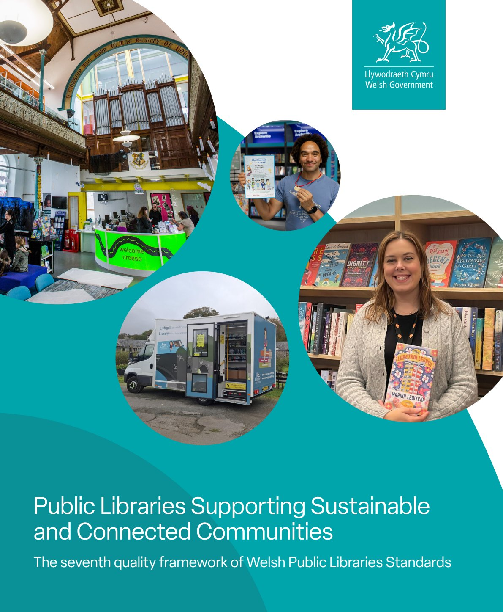
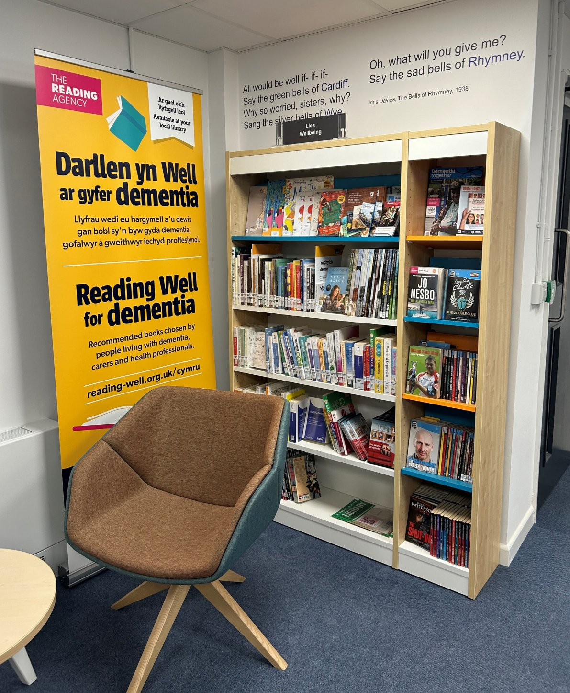

<!-- PAGE: 1 -->

# Public Libraries Supporting Sustainable and Connected Communities

## The Seventh Quality Framework of Welsh Public Libraries Standards (2025 to 2028)

<!-- PAGE: 2 -->

© Crown copyright 2025 Welsh Government  
WG50695  
Print ISBN 978-1-83715-287-2  
Digital ISBN 978-1-83715-289-6  

*Mae’r ddogfen hon ar gael yn Gymraeg hefyd / This document is also available in Welsh.*  
*Rydym yn croesawu gohebiaeth a galwadau ffôn yn Gymraeg / We welcome correspondence and telephone calls in Welsh.*

<!-- PAGE: 3 -->

## Contents

- [Ministerial Foreword](#ministerial-foreword) (p. 4)
- [1. Introduction](#1-introduction) (p. 7)
  - [1.1 The benefits of using public libraries](#11-the-benefits-of-using-public-libraries) (p. 7)
  - [1.2 Structure of the Seventh Framework](#12-structure-of-the-seventh-framework) (p. 8)
  - [1.3 Fulfilling the statutory duty](#13-fulfilling-the-statutory-duty) (p. 9)
  - [1.4 Community-managed libraries](#14-community-managed-libraries) (p. 10)
- [2. Context](#2-context) (p. 12)
- [3. Core Entitlements](#3-core-entitlements) (p. 13)
- [4. Quality Indicators](#4-quality-indicators) (p. 15)
  - [4.1 Quality Indicators with targets](#41-quality-indicators-with-targets) (p. 15)
  - [4.2 QIs without targets](#42-qis-without-targets) (p. 17)
- [5. Reporting, monitoring, and assessment](#5-reporting-monitoring-and-assessment) (p. 20)
- [6. How public libraries contribute to Government priorities](#6-how-public-libraries-contribute-to-government-priorities) (p. 22)
- [7. Community-managed libraries](#7-community-managed-libraries) (p. 22)
- [Endnotes](#endnotes) (p. 24)
- [Image Credits](#image-credits) (p. 24)

<!-- PAGE: 4 -->

## Ministerial Foreword

> ### Summary
>
> Public libraries are at the heart of our local communities in Wales. They are a precious resource providing everyone with free access to books and information in physical and increasingly in digital format, but they are also much more than this. They provide a safe and welcoming warm space for people of all ages to meet and participate in social activities, to access technology and, where needed, to receive support in navigating an increasingly digital world.
>
> **Jack Sargeant**  
> *Minister for Culture, Skills and Social Partnership*

Public libraries are an integral part of our social infrastructure and make a valuable contribution to the lives of individuals and communities. Becoming a library member can help to ease social isolation and loneliness, library services support health and well-being by guiding people to reliable, authentic sources of information and through partnerships with health service providers. They are often the first cultural activity that children experience and as children develop, libraries support their literacy skills, reading, and learning, and open the world up for them.

The Welsh Government and local authorities have a strong record of working together to deliver improvements to library services for the benefit of users. I am pleased that the Welsh Government and local authorities have been able to work together and collaborate to develop this new framework of standards, which ensures that libraries will continue to develop and to provide a high-quality service to their communities.

<!-- PAGE: 5 -->

I am conscious that the provision of a library service needs to be balanced alongside other demands. Each local authority must consider carefully what is practical and possible to deliver, but always bear in mind the statutory requirement to provide a ‘comprehensive and efficient service’ as required by the Public Libraries and Museums Act 1964. The Welsh Public Library Standards provide the framework for the assessment of the level of provision. They are also a mechanism to enable planning and to support development.

I encourage each local authority to use the framework to develop its services and continue to engage actively with its communities to help design and deliver services that meet local needs. The Standards will enable local authorities to assess the impact of their services and to showcase their achievements, demonstrating that public libraries are dynamic, welcoming, inclusive spaces that contribute significantly to the Well-being of Future Generations goals.

I welcome this new framework of the Standards and the opportunities it provides to continue the positive partnership between Welsh Government and local authorities to deliver outstanding public library services for Wales.

**Jack Sargeant**  
*Minister for Culture, Skills and Social Partnership*

<!-- PAGE: 6 -->

*Bridgend Library (Libraries Wales photo bank).*

<!-- PAGE: 7 -->

## 1. Introduction

### 1.1 The benefits of using public libraries

Using public libraries benefits both individuals and communities. They contribute to mental health and wellbeing, social inclusivity, and community cohesion. As well as supporting literacy and reading for pleasure, providing access to reliable information, and promoting digital inclusion, libraries are trusted public spaces where people can meet, learn, and access other services.

Research has shown that public libraries deliver substantial social and economic value, generating returns many times greater than their operating costs. By supporting early literacy, educational attainment, health and wellbeing, digital skills, and community resilience, public libraries play an essential role in creating a fairer, more prosperous, and sustainable Wales for future generations.[^1]

<!-- PAGE: 8 -->

Increasingly public libraries are co-locating with other local authority services and using a community hub model. This allows their users to access or be directed to other services to support job seeking, accessing benefits, referrals to social services and health professionals at the same time as a visit to the library. Co-location can bring benefits in terms of footfall, shared costs, and convenient access to multiple services under one roof.

### 1.2 Structure of the Seventh Framework

The Seventh Quality Framework consists of:

- **Context:** Background information on the authority and its library service (Section 2).
- **Core Entitlements:** 13 fundamental entitlements that the public can expect from their library service (Section 3).
- **Quality Indicators with Targets:** 4 key input and service indicators with specific quantitative targets (Section 4.1):
  - WPLSQI A1: Core Entitlements
  - WPLSQI A2: Welsh language resources
  - WPLSQI A3: Opening hours
  - WPLSQI A4: Staffing
- **Quality Indicators without Targets:** 7 outcome and performance measures monitored over time (Section 4.2):
  - WPLSQI B1: Making a difference
  - WPLSQI B2: Customer satisfaction
  - WPLSQI B3: Digital inclusion and support
  - WPLSQI B4: Support for health and well-being
  - WPLSQI B5: Support for learning and skills
  - WPLSQI B6: Use of the service
  - WPLSQI B7: Efficient management and resource allocation

Related Quality Indicators: A2, A3, B1, B4.

<!-- PAGE: 9 -->

### 1.3 Fulfilling the statutory duty

The Public Libraries and Museums Act 1964[^4] (hereafter the Act) makes it a duty of the relevant Welsh Ministers (at the time of publication, the Minister for Culture, Skills and Social Partnership):

> “to superintend, and promote the improvement of, the public library service provided by local authorities in Wales, and to secure the proper discharge by local authorities of the functions in relation to libraries conferred on them as library authorities by or under this Act”.

Since 2002, the Welsh Ministers have fulfilled this duty through a cycle of Welsh Public Library Standards frameworks. These frameworks have established core standards of service provision, driven continuous service improvement, and provided a transparent mechanism for monitoring and public accountability.

Section 7(1) of the Act establishes the general statutory duty of every library authority to provide a ‘comprehensive and efficient library service for all persons desiring to make use thereof.’

<!-- PAGE: 10 -->

### 1.4 Community-managed libraries

Guidance issued by the Welsh Government in 2015 on community managed libraries was updated for Framework 6 and is included here, at Section 7. It includes criteria to be fulfilled in order that a community managed library might be included in the library service’s annual return as part of statutory provision.

Where community-managed libraries form part of an authority’s network, authorities must provide clear evidence of ongoing professional support, collection maintenance, system integration, and quality assurance when making their assessment against these standards.

<!-- PAGE: 11 -->

Section 4 describes the 11 Quality Indicators, which are of three broad types:

- **Input indicators:** Concerned primarily with what the library service will provide for the citizens of Wales in key areas in order that the Core Entitlements can be delivered (e.g. staff, opening hours, materials).
- **Output indicators:** Concerned with levels of use (visits, issues, electronic downloads, enquiries, events). When considered alongside input indicators, they provide evidence of efficiency and value for money.
- **Outcome and impact indicators:** Concerned with the difference that the library service makes to the lives of individuals and communities (health and wellbeing, learning, literacy, digital inclusion, cultural engagement).

Further guidance on definitions and methodology is provided in the supplementary guidance document to help local authorities.[^5]

<!-- PAGE: 12 -->

## 2. Context

The form in which library services are delivered across Wales varies both between and within authorities. This trend looks set to continue. As a result, it is important to collect contextual data about each service in order to help the Independent Assessor and Welsh Government situate the data from the return.

Authorities are required to report annually on the following contextual information:

- Resident population of the local authority area
- Number of Welsh speakers in the authority
- Geographic characteristics and deprivation profile
- Total number of static service points (full-time and part-time)
- Total number of mobile libraries and community stops
- Co-located facilities and community hubs
- Community-managed libraries operating in the area
- Partnership delivery models and shared service arrangements

This contextual information helps inform the qualitative evaluation of each service without being graded as a quality indicator.

<!-- PAGE: 13 -->

## 3. Core Entitlements

The Core Entitlements have been revised and refocused for Framework 7, to enable the public to know what they can expect from their public library service. These entitlements are initially self-assessed by each authority. A number of questions are specified, which the authority is required to consider when making their self-assessment. It is not necessary to be able to answer every question positively to meet the core entitlement, but justification for the assessment, which could refer to other relevant provision, should be provided in the return. The self-assessment will be reviewed by the Independent Assessor and moderated by the Peer Reference Group to ensure consistency between authorities.

**WPLSCE 1:** Local authority library services are free to join, and open to all.

**WPLSCE 2:** Local authority library services ensure friendly, knowledgeable, and qualified staff are on hand to help customers.

**WPLSCE 3:** Local authority library services provide customers with access to a range of services, activities, and high-quality resources in a range of formats to support learning and information seeking throughout life, reading for pleasure, community participation, cultural experiences, recreation, and health and well-being.

**WPLSCE 4:** Local authority library services provide services, facilities, and information resources accessible to individuals and groups with particular needs.

**WPLSCE 5:** Local authority library services provide appropriate safe, attractive, and accessible spaces and offer suitable staffed opening hours.

**WPLSCE 6:** Local authority library services lend books for free, and deliver free access to information, including online resources (available remotely 24 hours a day) for people who live, work or study in the area.

**WPLSCE 7:** Local authority library services provide free use of the Internet including Wi-Fi, as well as access to digital equipment for people who live, work or study in the area.

**WPLSCE 8:** Local authority library services provide customers with access to services, cultural activities, and high-quality resources in the Welsh language.

**WPLSCE 9:** Local authority library services work in partnership to share catalogues and facilitate access to the resources of all Welsh public libraries.

**WPLSCE 10:** Local authority library services work with a range of partners to promote and deliver services to new and diverse audiences, enabling more people to benefit from those services.

**WPLSCE 11:** Local authority library services regularly consult customers to gather their views on the service and information about their changing needs.

**WPLSCE 12:** Local authority library services provide access to their library service strategy, policies, objectives, and vision, in print and online, in a range of languages appropriate for the community.

**WPLSCE 13:** Local authority library services provide support to help improve customers’ digital skills and confidence.

<!-- PAGE: 14 -->

*Reading Well collection in Rhymney Library (Bethan Lee).*

<!-- PAGE: 15 -->

## 4. Quality Indicators

The Quality Indicators in Framework 7 build on the previous framework and include additional measures covering the outcomes and impact of the library service. They fall into two broad types:

- Those with targets, and
- Those which are provided for monitoring and benchmarking performance over time.

### 4.1 Quality Indicators with targets

Targets for each of the following indicators are specified below:

**WPLSQI A1: Core Entitlements**

Authorities will report on their compliance with the 13 Core Entitlements. The target is to meet all 13 Core Entitlements.

**WPLSQI A2: Welsh language resources**

Authorities will:

**a.** Achieve a level of spend on Welsh language resources of no less than £750 per 1,000 Welsh speaking resident population, or 4% of the total materials budget, whichever is the higher.

**b.** Achieve a level of issues of Welsh language resources of no less than 120 per 1,000 Welsh speaking resident population.

Authorities are advised to refer to the supplementary guidance for detailed information about how to report on this.

<!-- PAGE: 16 -->

**WPLSQI A3: Opening hours**

**a.** Welsh public libraries should achieve a level of paid staff opening hours across all static service points administered by the authority of no less than 120 hours per annum per 1,000 resident population.

**b.** Authorities will report on the number of opening hours across all static service points where the service is delivered solely by volunteers.

**c.** Authorities will report the total unstaffed opening hours (e.g. Open+ or similar automated access).

**d.** Authorities will report on scheduled mobile library opening hours.

**WPLSQI A4: Staffing**

**a.** Welsh public libraries should achieve a total staff establishment of no less than 3.6 full-time equivalent (FTE) staff per 10,000 resident population.

**b.** Welsh public libraries should achieve a level of qualified staff of no less than 0.7 FTE qualified staff per 10,000 resident population.

**c.** The head of the library service should hold a recognised professional qualification in librarianship or information management.

**d.** Authorities will report on the number of staff holding Welsh language skills at ALTE Level 3 or above.

**e.** Authorities will report on expenditure on staff training and development as a percentage of total staff budget.

<!-- PAGE: 17 -->

### 4.2 QIs without targets

**WPLSQI B1: Making a difference**

This indicator assesses the positive impact of library use on people’s lives. Authorities will report, at least once in the three-year period:

**a.** The percentage of adults who think that the library has made a positive difference to their lives (with an open-ended option to provide an example).

**b.** The percentage of young people who think that the library has made a positive difference to their lives.

**c.** Case studies illustrating how the library service has made a positive difference to individual users or community groups.

**WPLSQI B2: Customer satisfaction**

Authorities will report, at least once in the three-year period:

**a.** The percentage of adults who rate the library service as ‘good’ or ‘very good’.

**b.** The percentage of young people who rate the library service as ‘good’ or ‘very good’.

**c.** The percentage of customers who rate the customer care provided by staff as ‘good’ or ‘very good’.

**WPLSQI B3: Digital inclusion and support**

Authorities will report annually on:

**a.** The number of public access computers available per 1,000 resident population.

**b.** The percentage of public access computers in use during opening hours.

**c.** The number of Wi-Fi sessions recorded across all service points.

**d.** The number of digital skills training sessions provided by the service.

**e.** The number of attendances at digital skills training sessions (adults and children separate).

<!-- PAGE: 18 -->

**f.** The total number of electronic downloads (guidance to suggest looking across the range of resources available and using the download stats from each Welsh Government funded service e.g. e-books, e-audio, e-magazines, e-newspapers, family history resources, and driving theory test as provided); and

**g.** The number of customers helped by means of informal support during the year divided by the resident population.

Where authorities provide other digital support (e.g. loaning laptops, Wi-Fi routers, or providing free SIM cards), they are encouraged to do so and report accordingly.

<!-- PAGE: 19 -->

**WPLSQI B4: Support for health and well-being**

Authorities will:

**a.** Provide a brief description of the types of services, resources, and activities your library service provides to support individual and community health and wellbeing (e.g. signposting to external health and well-being services; resources to support health and well-being within the library and online; activities to support health and wellbeing; warm spaces provision; and dementia-friendly services).

**b.** Report on the number of attendees at health and well-being activities.

**WPLSQI B5: Support for learning and skills**

Authorities will report annually on:

**a.** The number of learning and literacy activities provided for children, young people, and adults.

**b.** The total attendance at learning and literacy activities.

**WPLSQI B6: Use of the service**

Authorities will report annually on:

**a.** The total number of physical visits to library service points per 1,000 resident population.

**b.** The total number of virtual visits to the library website and digital catalogue per 1,000 resident population.

**c.** The total number of books and physical items borrowed per 1,000 resident population.

**WPLSQI B7: Efficient management and resource allocation**

Authorities will report annually on:

**a.** Net revenue expenditure on the library service per 1,000 resident population.

**b.** Total capital expenditure on library infrastructure and assets.

**c.** Breakdown of expenditure by categories:
  - Staff expenditure
  - Materials expenditure (books, periodicals, digital resources)
  - Premises costs
  - Other operational costs

<!-- PAGE: 20 -->

## 5. Reporting, Monitoring, and Assessment

The statutory requirements of public library service provision in Wales are enshrined in the Public Libraries and Museums Act 1964. The performance indicators listed here will assist the Welsh Government in assessing whether local authorities are fulfilling their statutory duties under the Act.

Local authorities will submit an annual report to the Welsh Government by midsummer following the end of each financial year. The return will cover:

- Contextual data on the authority and service network (Section 2).
- Self-assessment against the 13 Core Entitlements (Section 3).
- Performance data against the Quality Indicators with targets (Section 4.1).
- Monitoring data and case studies for Quality Indicators without targets (Section 4.2).
- A concise statement of key achievements, challenges, and future strategic direction.

The Welsh Government appoints an Independent Assessor to review all authority returns. The Independent Assessor produces an individual assessment report for each authority, which is moderated by a Peer Reference Group comprising representatives from Welsh local government and the library profession.

An annual all-Wales summary report is published by the Welsh Government, highlighting national trends, areas of good practice, and identifying challenges facing the public library sector at a national level.

<!-- PAGE: 21 -->

A concise description of the authority’s future direction and plans for the library service over the following year will be included in their submission. Authorities will also be required to confirm that feedback, in the form of opinion on the year’s performances achieved, has been presented to the relevant Cabinet Member or Council Committee.

Where an authority fails to meet core entitlements or shows persistent underperformance against key targets, the Welsh Government will engage directly with council leadership. In cases of serious or persistent failure, the Welsh Ministers may exercise their statutory default powers under Section 10 of the Public Libraries and Museums Act 1964.

<!-- PAGE: 22 -->

## 6. How Public Libraries Contribute to Government Priorities

Public library services contribute to the delivery of a wide range of Welsh Government priorities. The list of strategies below is illustrative not exhaustive. Other strategies and policies may come into effect during the lifetime of this framework:

- **Well-being of Future Generations (Wales) Act 2015:** Contributing across all seven national well-being goals: a prosperous Wales, a resilient Wales, a healthier Wales, a more equal Wales, a Wales of cohesive communities, a Wales of vibrant culture and thriving Welsh language, and a globally responsible Wales.[^6]
- **Digital Strategy for Wales:** Promoting digital inclusion, essential digital skills, and access to devices and high-speed connectivity.[^9]
- **Anti-racist Wales Action Plan:** Ensuring libraries provide inclusive, culturally diverse, and representative collections and spaces.[^10]
- **LGBTQ+ Action Plan for Wales:** Providing welcoming, safe spaces, relevant resources, and diverse community events.[^11]
- **Age Friendly Wales:** Supporting older citizens through social connection, digital support, and accessible services.[^12]
- **Connected Communities Strategy:** Tackling loneliness and social isolation through community spaces and shared activities.[^13]
- **Cymraeg 2050:** Supporting the Welsh Government’s goal of reaching one million Welsh speakers by providing Welsh language resources, activities, and bilingual services.

## 7. Community-Managed Libraries

Where a local authority works with a community organisation to sustain library provision, the facility may only be counted as part of the statutory public library service if it meets the Welsh Government’s criteria for community-managed libraries.

Community-supported models where the local authority continues to provide professional staff, core stock, and IT systems, while supported by community volunteers, are eligible for inclusion.

<!-- PAGE: 23 -->

Models involving the transfer of the building and resources to the community and entirely run by volunteers with minimal (or no) ongoing assistance from the local library service in managing the facility are not eligible for inclusion.

Different models may exist within an authority. Authorities are required to provide details of all community-managed facilities in their area, distinguishing between:

- **Community Supported Libraries:** Maintained by the local authority with significant volunteer support and input, retaining full access to the shared national catalogue, LMS, and professional oversight (eligible for inclusion in statutory returns).
- **Community Managed Libraries:** Managed by community groups with some support from the authority (e.g. stock exchange or advice), but without full LMS integration.
- **Independent Community Libraries:** Fully transferred to community ownership with no ongoing authority support (excluded from statutory returns).

Authorities must report on the performance of eligible community-supported libraries and provide contextual information regarding those not included, where available.

<!-- PAGE: 24 -->

## Endnotes

[^1]: Shared Intelligence (2024). CILIP, *Come Rain or Shine: Preparing public libraries for the future in an age of uncertainty*. London, CILIP.
[^2]: OECD (2010). *PISA 2009 Results. Learning to learn: Student Engagement, Strategies and Practices* (Volume III). PISA, OECD Publishing: Paris. Available at: <https://doi.org/10.1787/9789264083943-en>.
[^3]: Libraries Connected (2018). *Universal Library Offers*. Available at: <https://www.librariesconnected.org.uk/page/universal-library-offers>.
[^4]: Public Libraries and Museums Act 1964. Available at: <https://www.legislation.gov.uk/ukpga/1964/75/contents>.
[^5]: Email <culture@gov.wales> to request access to the definitions and guidance document.
[^6]: The Well-being of Future Generations (Wales) Act 2015: The Essentials. Available at: <https://www.gov.wales/well-being-future-generations-act-essentials-html>.
[^7]: Libraries and Archives. Available at: <https://www.gov.wales/libraries-archives>.
[^8]: Well-being of Future Generations (Wales) Act 2015: The Essentials. Available at: <https://www.gov.wales/well-being-future-generations-act-essentials-html>.
[^9]: Digital Strategy for Wales. Available at: <https://www.gov.wales/digital-strategy-wales-html>.
[^10]: Anti-racist Wales Action Plan. Available at: <https://www.gov.wales/anti-racist-wales-action-plan>.
[^11]: LGBTQ+ Action Plan for Wales. Available at: <https://www.gov.wales/lgbtq-action-plan-wales>.
[^12]: Age Friendly Wales: Our Strategy for an Ageing Society. Available at: <https://www.gov.wales/age-friendly-wales-our-strategy-ageing-society>.
[^13]: Loneliness and Social Isolation (Connected Communities). Available at: <https://www.gov.wales/loneliness-and-social-isolation-connected-communities>.

## Image Credits

- **Cover image 1:** Bargoed Library (Libraries Wales photo bank)
- **Cover image 2:** Joseph Coelho with Summer Reading Challenge certificate (Awen libraries)
- **Cover image 3:** Llanfairfechan Library opening (Conwy libraries)
- **Cover image 4:** Mobile Library Ysbyty Ifan (Conwy libraries)
- **Page 5:** Craft session in Bangor Library (Gwynedd libraries)
- **Page 6:** Bridgend Library (Libraries Wales photo bank)
- **Page 9:** Carmarthen Library (Libraries Wales photo bank)
- **Page 10:** Finn with Summer Reading Challenge certificate (Conwy libraries)
- **Page 11:** Colwyn Bay staff on World Book Day (Conwy libraries)
- **Page 12:** Local group using the Wi-Fi in Tywyn Library (Gwynedd libraries)
- **Page 13:** Children’s library in Neuadd Dwyfor (Juanita Foster-Jones)
- **Page 14:** Reading Well collection in Rhymney Library (Bethan Lee)
- **Page 16:** Yr Hobyd (Conwy libraries)
- **Page 17:** A group of learners enjoying a cuppa and a chat in Tywyn Library (Gwynedd libraries)
- **Page 18:** Weaving workshop at Barmouth Library (Gwynedd libraries)
- **Page 19:** Free SIM cards (Awen libraries)
- **Page 22:** Welsh for Meirionnydd Children at Tywyn Library (Gwynedd libraries)
