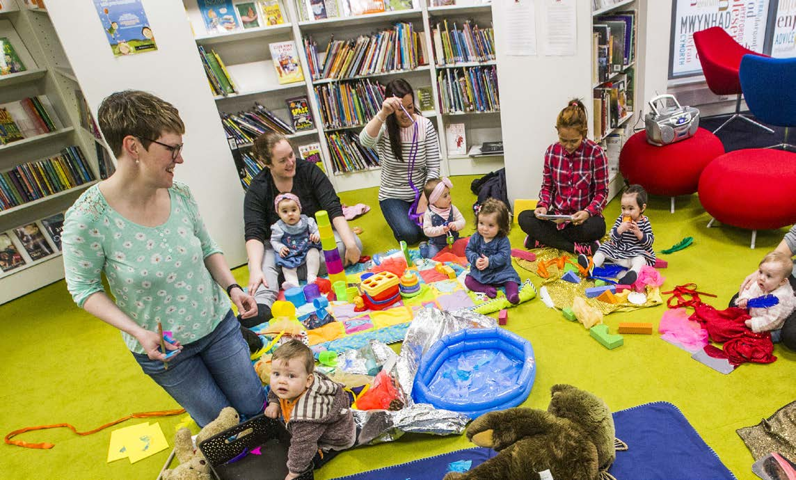
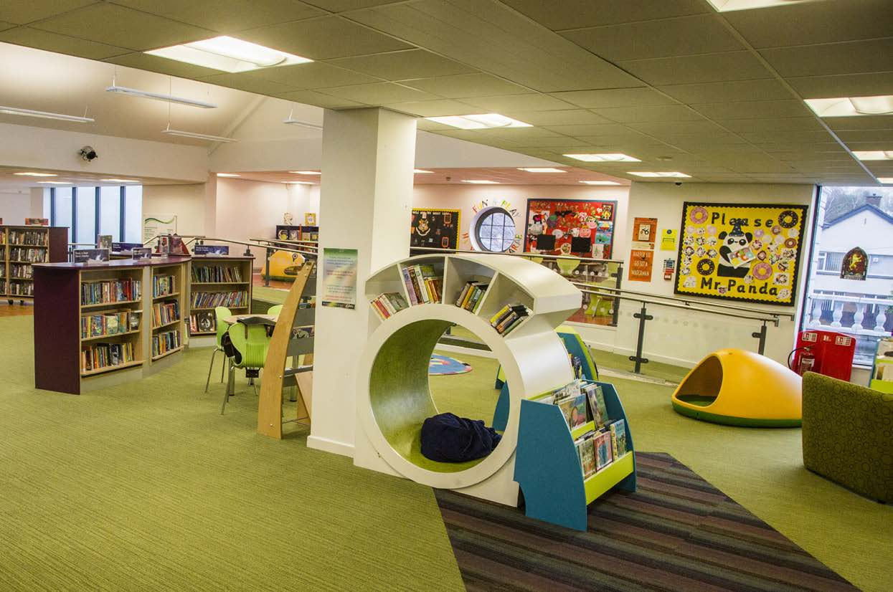

<!-- PAGE: 1 -->

Connected and
Ambitious Libraries:

The sixth quality framework of Welsh 
Public Library Standards 2017-2020

1 <!-- PAGE: 2 -->

Contents

Foreword
3

**1.** Introduction 4

**2.** Core entitlements 10

**4.** Reporting, monitoring and assessment 22

**3.** Quality indicators 12

5. The Well-being
of Future
Generations Act
24

6. Community 
managed libraries
26

2 <!-- PAGE: 3 -->

Foreword

Public libraries connect people, 
information and culture. The Welsh 
Government and local authorities have an 
established record of working well together 
to achieve ambitious goals for our library 
services. I am delighted to be working 
collaboratively with local authorities on 
a new framework of Welsh Public Library 
Standards, to ensure that we continue to 
provide the citizens of Wales with high 
quality public library services.

As library users know, libraries provide 
everyone with a wealth of information, 
resources, activities and cultural 
opportunities. They are places of ambition 
and learning where people can gain 
new skills, leading to job success and 
prosperity; they encourage people to 
be active and healthy through a range 
of health information services and 
partnerships; and they connect and unite 
people, not only with each other and local 
communities, but also with culture and the 
world beyond Wales. They also make a 
valuable contribution to the seven goals of 
the Well-being of Future Generations Act.

All parts of the public sector are facing 
considerable financial pressure, including 
public library services. The expectations 
of citizens, for a high quality library 
service, need to be balanced with what is 
practical and possible to deliver, alongside 
the statutory requirement to provide a 
“comprehensive and efficient” service 
as specified in the Public Libraries and 
Museums Act 1964.

The Welsh Public Library Standards 
framework provides a mechanism to 
enable service providers to plan their 
provision, and for the public to know what 
they can expect from their library service. 
The framework also enables me to assess 
provision and performance of Welsh public 
library services as part of my statutory
duty under the Public Libraries and 
Museums Act 1964.

I am pleased that this new framework 
increases the emphasis on outcome 
and impact measures to help identify 
the wider benefits of using the library 
service. In conjunction with promoting the 
Standards to make our library services 
as sustainable and efficient as possible, 
further consideration will also be given to 
the regional consortia model which was 
outlined in the Expert Review of Public 
Libraries and the Scoping a New Future
for Welsh Public Libraries report.

I welcome this new framework of the 
Standards and the opportunities that 
it provides to continue the positive 
partnership between the Welsh 
Government and local authorities to 
continue to deliver an outstanding 
connected and ambitious public
library service in Wales.

Ken Skates, AM

Cabinet Secretary for
Economy and Infrastructure

3 <!-- PAGE: 4 -->

1. Introduction

“Freedom, Prosperity and the Development of society and

individuals are fundamental human values. They will only be 
attained through the ability of well-informed citizens to exercise 
their democratic rights and to play an active role in society. 
Constructive participation and the development of democracy 
depend on satisfactory education as well as on free and unlimited 
access to knowledge, thought, culture and information.

“The public library, the local gateway to knowledge, provides a basic

condition for lifelong learning, independent decision-making and 
cultural development of the individual and social groups.”1

1.1. The benefits of using public libraries

Library service engagement with 
individuals and with the wider community 
drives benefits in many of the Welsh 
Government’s priority areas such as 
prosperity, resilience, equality, cohesive 
communities, culture, learning and health 
and well being. How the library interacts 
with its stakeholders – chiefly the users 
(and potential users) of the service – is
key to the provision of a quality service. 
User perceptions of the services available 
derive from their experiences.

Libraries which engage appropriately with 
their customers will provide the maximum 
benefits both for individuals and the 
community. As well as providing training 
and learning support for individuals, 
libraries contribute to society in other
ways, such as providing access to 
computers and e-government for digitally 
excluded members of the community.

The public library has a key role in social
inclusion. It may be the only place in
the community where users can spend 
time in a safe and neutral environment.
Supporting job-seekers in their search
for work contributes to the local – and

4

1 UNESCO Public Library Manifesto, available at http://www.unesco.org/webworld/libraries/manifestos/libraman.html (accessed 23-08-2016)

national – economy. By providing 
specialist facilities and services for those 
in the community who might have special 
needs, libraries contribute to health and 
well‑being. Such benefits will only be 
achieved if the library provides equality 
of access for all. Much information is 
now more easily accessible online – 
indeed, some is only available online – 
and libraries are uniquely positioned to 
facilitate access to resources which may 
be too costly for individuals (e.g. the cost 
of the basic hardware, Internet access or 
the resource subscription).

Libraries play a key role in providing 
information, promoting knowledge and 
developing skills for people of all ages 
and all walks of life. From children's first 
steps in listening to stories and learning to 
read, to providing quiet spaces for study, 
and supporting older people in using new 
technologies, libraries contribute to the 
delivery of literacy targets, information 
literacy and digital inclusion.

Good libraries play an important part in
shaping people's views of local 
government. In order to deliver quality, <!-- PAGE: 5 -->

sustainable services to the public, 
libraries need active leadership and a 
programme for development enabling 
them to respond in a timely way to the 
changing information and cultural needs 
of their local communities. Staff must 
have the skills, knowledge and confidence 
to deliver services and meet customer 
needs, demonstrated by appropriate 
professional qualifications. Libraries have 
the opportunity to contribute to a range 
of wider local and national government 
agendas, but this will only happen if the 
library is pro-active in promoting its role, 
based on a strong vision linked to
those agendas.

1.2. What this means for the people
of Wales

The sixth framework of Welsh public library 
standards builds on the developments in 
the fifth framework. It comprises 12 core 
entitlements and 16 quality indicators to 
monitor how well library services realise 
these benefits for the people of Wales. The 
mapping between benefits and indicators 
is not a simplistic one, as measuring 
outcomes and impacts at a service-wide 
level cannot be achieved directly, but must
be inferred from broader indicators.

The table below shows the indicators in 
this framework which are most directly 
related to some of the key benefits of using 
public libraries. Libraries which perform 
well on these indicators will be engaging 
appropriately with their customers to make 
a difference to their lives.

5 <!-- PAGE: 6 -->

Outcomes and impacts	
Core entitlements
Quality indicators

People in Wales will be able to increase their 
knowledge / skills having used the library
2, 3
1, 3, 5

People in Wales will be able to take part in 
reading and other cultural events organised 
by the library service

People in Wales will feel part of a community 
using the library service
3, 11
1, 7, 8

People in Wales will be able to take 
advantage of the opportunities offered in 
the digital world using the library service

Personal health and well-being is enhanced 
by using the library
3, 4
1, 4

People in Wales can participate more fully in 
local affairs via the facilities in the library
3, 6
3, 11

Other core entitlements and quality 
indicators are concerned with the effective 
management of services, which underpins 
the effective delivery of the outcomes and 
impacts. All can be related to one or more 
of the seven goals of the Well-being of 
Future Generations Act; details are given in 
Section 5.

1.3. Fulfilling the statutory duty

The Public Libraries and Museums Act 
19642 makes it a duty of the relevant 
Welsh Ministers (currently the Cabinet 
Secretary for Economy and Infrastructure) 
“to superintend and promote the 
improvement of the public library service 
provided by local authorities and to 
secure the proper discharge by local 
authorities of the functions in relation to 
libraries conferred upon them as library 
authorities under this Act”.

There is general consensus among 
stakeholders concerned with the provision 
of public library services in Wales that 
these performance measurement 
frameworks, introduced and administered 
2 Available at http://www.legislation.gov.uk/
ukpga/1964/75/contents

6

3
4, 6, 9, 10, 12

2, 6, 7
4, 9, 11

Under the same Act, library authorities are 
required to “provide a comprehensive and 
efficient library service for all persons 
desiring to make use thereof”.

Since 2002, the Welsh Ministers have 
fulfilled this duty through the Welsh 
Public Library Standards (WPLS, or, the 
Standards). The first framework ran from 
2002 to 2005 with subsequent frameworks 
covering the periods 2005-08, 2008-11, 
2011-14 and 2014-17. Each individual 
framework evolved to reflect the changing 
needs and expectations of public library 
users. In addition to the fulfilment of 
statutory duties, the WPLS framework 
plays a valuable role in supporting the 
development of public library services.

<!-- PAGE: 7 -->

by the Welsh Government for the sector, 
have helped public library services to 
improve in a number of ways and in key 
areas. For example, as a result of the 
Standards, there have been significant 
improvements in service areas such as the 
delivery of requests and provision of ICT 
facilities and services, leading to enhanced 
outcomes for library customers.

Local authorities have a statutory duty 
(under section 7 of the Act) to provide a 
library service and encourage both adults 
and children to make full use of that library 
service. The performance indicators listed 
here will assist the Welsh Government in 
assessing whether or not local authorities 
in Wales are fulfilling their duties under 
the 1964 Act, and in assessing the 
comprehensiveness and efficiency, in 
terms of the manner of delivery, of library 
services in Wales.

1.4. Community managed libraries

Since about 2014 the number of 
independent and semi-independent 
libraries in Wales, frequently referred to 
as community managed libraries, has 
increased. Guidance issued by the Welsh 
Government in 2015 on community 
managed libraries has now been updated 
and is included here, at Section 6, rather 
than in a separate document, as previously. 
It includes criteria to be fulfilled in order 
that a community managed library might 
be included in the library service’s annual 
return as part of the statutory service, and 
details of the data to be provided on all 
community managed libraries.

1.5. The sixth quality framework

The aims of this sixth framework of Welsh 
Public Library Standards are to:

•	 enable the Cabinet Secretary for 
Economy and Infrastructure to fulfil 
the statutory requirements of the 
1964 Act in respect of superintending 
the provision of a ‘comprehensive 
and efficient’ library service by local 
authorities;

•	 provide a robust assessment of the 
performance of library services;

•	 have clear links to the Welsh 
Government’s programme for 
government³, to ensure credibility 
across local government in Wales;

•	 be relevant and useful to all local 
authority library services in Wales;

•	 be transparent, easily understood and 
accepted by all stakeholders;

•	 incorporate outcome measures to show 
the benefits of using libraries;

•	 act as a driver for improvements to 
library services and local communities; 
and

•	 minimise the burden of data collection 
on library authorities.

3 Taking Wales Forward 2016-2021, available at http://gov.wales/docs/
strategies/160920-taking-wales-forward-en.pdf

7 <!-- PAGE: 8 -->

The framework has been based largely 
on the fifth framework, updated to take 
account of the changed local authority 
environment within which library services 
must work, and continues to provide 
opportunities for libraries to deliver 
services in innovative ways and the 
flexibility to make best use of the resources 
available to them. It will come into operation 
on 1st April 2017, and libraries will make 
their first report against its requirements 
in the summer of 2018. This document 
describes the new framework in detail.

Section 2 lists the 12 core entitlements, 
and self-assessment prompts will be 
provided in the guidance for library staff.

Section 3 describes the 16 quality 
indicators, which are of three broad types.

•	 Input indicators are concerned primarily 
with what the library service will provide 
for the citizens of Wales in key areas
in order that the core entitlements can 
be delivered.

•	 Output indicators are concerned 
with levels of use. When considered 
alongside input indicators, they can give 
an indication of the efficiency of delivery 
of the service.

•	 Outcome and impact indicators measure 
the direct or indirect effects of the library 
service on its users, and on the wider 
community. They show the difference 
libraries make to people’s lives.

Most indicators will be reported every year; 
some may be reported once in the three 
year period, for example, where user survey 
data are required. For some indicators, 
formal targets are set, although such 
targets are not appropriate in all cases.

Definitions of the various terms and 
guidance on methods of data collection are 
not specified in this document; however 
these will be included with the reporting 
template provided to library services, 
and are available on request⁴. In all cases, 
detailed guidance on data collection and 
calculation will be provided to library 
authorities to ensure consistency and 
4  See http://gov.wales/topics/culture-tourism-sport/
museums-archives-libraries/?lang=en for details

Libraries will be expected to compare their 
performance on all indicators with previous 
years, and to meet the targets where these 
are set. Benchmarking of authorities will be 
possible when all results are available.

8

The nature of the geography, distribution 
of population and other factors within 
individual authorities can cause significant 
variations in the approaches necessary 
to the planning and delivery of library 
services. For this reason, Welsh library 
authorities are offered alternatives against 
which to measure their services in some 
of the indicators described, and should 
choose the most appropriate to reflect 
their circumstances.

<!-- PAGE: 9 -->

comparability. Existing data will be utilised 
wherever practicable. Where appropriate, 
international standard definitions and 
methods have been adopted.

Section 4 of this document details the 
reporting requirements, which include an 
element of self evaluation and descriptive 
reporting in addition to key service 
statistics and the performance indicators, 
and describes the monitoring and 
assessment process. A holistic view
of assessment will be taken.

Library performance will be judged on all 
the aspects of the framework, including 
compliance with the core entitlements, 
ranking on the quality indicators, how
many quality indicators are met in full
and in part, and the narrative providing

evidence of the impact of the service on 
individuals and the community.

Library provision spans a range of Welsh 
Government outcomes, offering a range
of services which often support two or 
more of the outcomes simultaneously.
The Well-being of Future Generations Act5 
lists seven broad areas of priority, and 
Section 5 of this framework document 
aligns the core entitlements and quality 
indicators with these areas, giving 
examples of the contribution the library 
service makes.

5 See http://gov.wales/topics/people-and-communities/
people/future-generations-act/?lang=en for details

9 <!-- PAGE: 10 -->

2. Core entitlements

A set of core library entitlements for Welsh 
citizens was first incorporated into Making 
a Difference, the fifth quality framework 
of Welsh Public Library Standards. These 
entitlements have been revised and 
refocused for this sixth framework, to enable 
the public to know what they can expect 
from their public library service.

These entitlements are initially self‑assessed 
by each authority. A number of questions 
are specified in the Guidance document, 
which the authority is required to take into 
account when making their self­‑assessment. 
It is not necessary to be able to answer 
every question positively to meet the 
core entitlement, but justification for the 
assessment, which could refer to other 
relevant provision, should be provided in 
the return. The self-assessment will be 
moderated by MALD, the Independent 
Adviser, and a small Reference Group of 
senior librarians to ensure consistency 
between authorities.

WPLSCE 1 Libraries in Wales will be free to 
join, and open to all.

WPLSCE 2 Libraries in Wales will ensure 
friendly, knowledgeable and qualified staff 
are on hand to help.

WPLSCE 3 Libraries in Wales will provide 
access to a range of services, activities 
and high quality resources in a range of 
formats to support lifelong learning, personal 
well-being and development, community 
participation, and culture and recreation.

WPLSCE 4 Libraries in Wales will provide 
appropriate services, facilities and 
information resources for individuals and 
groups with special requirements.

10

WPLSCE 5 Libraries in Wales will provide 
appropriate safe, attractive and accessible 
physical spaces with suitable staffed
opening hours.

WPLSCE 6 Libraries in Wales will lend 
books for free, and deliver free access to 
information, including online information 
resources available 24 hours a day.

WPLSCE 7 Libraries in Wales will provide
free use of the Internet and computers, 
including Wi-Fi.

WPLSCE 8 Libraries in Wales will provide 
access to services, cultural activities and 
high quality resources in the Welsh language.

WPLSCE 9 Libraries in Wales will work in 
partnership to share catalogues and facilitate 
access to the resources of all Welsh libraries.

WPLSCE 10 Libraries in Wales will work with 
a range of partners to promote and deliver 
services to new and diverse audiences, 
enabling more people to benefit from those 
services.

WPLSCE 11 Libraries in Wales will regularly 
consult users to gather their views on the 
service and information about their
changing needs.

WPLSCE 12 Libraries in Wales will provide 
access to the library service’s strategy, 
policies, objectives and vision, in print and 
online, in a range of languages appropriate 
for the community.

<!-- PAGE: 11 -->

11 <!-- PAGE: 12 -->

3. Quality indicators

The quality indicators in this sixth 
framework build on the previous 
framework, and include additional 
measures covering the outcomes and 
impact of the library service. They fall 
into two broad types; those which are 
provided for monitoring and benchmarking 
performance over time and between 
authorities, and those which have
specific targets.

WPLSQI 1 Making a difference

This selection of indicators assesses the 
impact of library use on people’s lives in a 
variety of ways. Although some are relevant 
to other areas of this framework, they are 
grouped together here as being key to the 
overall customer experience.

Authorities will report, at least once in the 
three year period:

12

a)	the percentage of adults who think

that using the library has helped them 
develop new skills;

b)	the percentage of young people who

think that the library helps them learn 
and find things out;

c)	the percentage of adults who have

found helpful information for health and 
well‑being at the library;

d)	the percentage of adults who experience

the library as an enjoyable, safe and 
inclusive place;

e)	the percentage of adults who think that

the library has made a difference to their 
lives.

Data will be collected from user surveys 
of adults and of children, which should 
be conducted in accordance with good 
statistical practice, at least once during <!-- PAGE: 13 -->

the three-year period of this framework. 
Authorities will be given guidance on 
the conduct of the survey and wording 
of questions to ensure comparability. 
Respondents answering ‘not applicable’
or ‘don’t know’ should be excluded from
the calculation.

Authorities may conduct more frequent 
surveys if they wish to do so and report 
accordingly.

WPLSQI 2 Customer satisfaction

Customer satisfaction is a key element of 
library performance. As with the indicators 
concerned with library impact (QI 1), some 
of these are relevant to other areas of 
this framework, but are grouped together 
here as being key to the overall customer 
experience.

Authorities will report:

a)	the percentage of adults who think that

the choice of books available in the 
library they use is ‘very good’ or ‘good’;

b)	the percentage of adults who think that

the standard of customer care in the 
library they use is ‘very good’ or ‘good’;

c)	the percentage of adults who think that

the IT facilities provided in the library 
they use are ‘very good’ or ‘good’;

d)	the percentage of adults who think that

overall the library they use is ‘very good’ 
or ‘good’;

e)	the average overall rating out of ten

awarded by users aged 16 or under for 
the library they use.

Data will be collected from user surveys 
of adults and of children, which should 
be conducted in accordance with good 
statistical practice, at least once in the 
three-year period of this framework.

It is appreciated that not all authorities 
wish to use the CIPFA PLUS suite of 
survey instruments (from which the above 
indicators are drawn), and guidance will 
be issued to ensure that authorities which

choose to use their own surveys will have 
comparable results. Authorities may 
conduct more frequent surveys if they wish 
to do so and report accordingly.

WPLSQI 3 Support for individual 
development

Libraries shall ensure that the following 
services are offered in all static service 
points open for 10 hours per week or more:

a)	basic support in the use of the ICT

infrastructure provided (including Wi-Fi) 
and in accessing the range of electronic 
information resources available;

b)	training to improve literacy, numeracy,

information and digital skills, and 
assistance in developing or enhancing 
capabilities to identify and access 
appropriate resources efficiently 
and effectively; critically evaluate 
information; and apply information 
appropriately to further objectives, such 
as educational, employment, health and 
well-being.

Training programmes may be developed 
and delivered with appropriate partners 
outside the library service;

c)	support for users to access local and

national e-government resources;

d)	reader development programmes/

activities for both adults and children.

The format of the support offered and 
frequency of any specific timetabled 
sessions should be appropriate both for 
the size of the service point and local 
community needs.

WPLSQI 4 Support for health and 
well‑being

a)	Libraries shall ensure that the following

services are offered in all static service 
points open for 10 hours per week
or more:

i.	
Book Prescription Wales scheme

ii.	
Better with Books scheme

13 <!-- PAGE: 14 -->

iii.	 Designated health and well-being

collection

iv.	 Information about healthier lifestyles

and healthy behaviours - leaflets, 
books etc

v.	
Signposting to health and well-being 
services

b)	Authorities will report the number of

static service points open for 10 hours 
per week or more in which the following 
services are available on a regular basis

i.	
Shared Reading groups (reading 
aloud together)

ii.	
Book clubs (discussion of chosen 
book)

iii.	 Macmillan cancer or other health

information partnerships

iv.	 Dementia Friendly services

v.	
Mental health awareness activities

14

WPLSQI 5 User training

This indicator assesses the extent to 
which sessions offered match local need, 
and the impact of those sessions for 
the participants. Reader development 
sessions; literacy, numeracy, information 
and digital skills sessions; ICT sessions, 
etc., should all be included. Include 
sessions arranged in collaboration with 
partner agencies. User training may have a 
general audience, or be targeted towards 
specific sub-groups of the population e.g. 
children, carers, unemployed persons, etc.

Sessions may require advance registration, 
or be open to all on a drop-in basis. Include 
sessions also reported under WPLSQI 4.

Authorities will report:

a)	the total number of attendances at pre-

arranged training sessions organised 
and/or hosted by the library service 
at its own service points or at other 
locations within the authority during the 
year, divided by the resident population, 
multiplied by 1,000;

<!-- PAGE: 15 -->

b)	the percentage of attendees at such

sessions who said that attendance 
helped them to achieve their goals;

c)	the number of customers helped by

means of informal training during the 
year, divided by the resident population, 
multiplied by 1,000.

Part b) of this indicator should ideally 
be derived from a simple feedback form 
offered to all attendees, but may be
based on sessions during one or more 
sample periods.

Part c) of the indicator may be derived 
by sampling. Authorities will be provided 
with guidance to ensure consistency of 
reporting.

WPLSQI 6 User attendances at library 
events

The purpose of this indicator is to estimate 
the attraction of library events for the 
library’s population to be served, and
the extent to which such events meet
local need.

a)	Authorities will report the total number

of attendances at events and activities 
organised by the library service at its own 
service points or at other locations within 
the authority during the year, divided by 
the resident population, multiplied by 
1,000.

Include events with literary, cultural or 
educational intent, e.g. author visits, reading 
groups, literary discussions, digital and 
information literacy workshops, genealogy 
workshops, health literacy, financial literacy, 
job seeking etc.

Events specifically for children are included, 
such as storytelling, poetry, music. Include 
events delivered by partner organisations in 
collaboration with the library service.

b)	Libraries shall ensure that events or

activities for those who have special 
requirements are offered in all static 
service points open for 10 hours per 
week or more. The events or activities 
may be promoted specifically for an 
intended group, or open to all, but with
a clear target group in mind.

Special requirements can include physical 
and health impairment, economic 
disadvantage (e.g. long-term unemployed), 
cultural difference (e.g. non-native speakers, 
new arrivals), educational background, or 
other circumstances that require special 
library services. Authorities should provide 
specific examples of such events and list 
joint working with relevant social inclusion 
organisations and partners.

WPLSQI 7 Location of service points

No stipulation is made with regard to 
minimum opening hours of static libraries 
(on a site by site basis) however, authorities 
are asked to consider the viability of service 
points which are open for fewer than 10 
hours per week. Equally, no stipulation is 
made with regard to length or frequency of 
mobile library stops, however it is expected 
that mobile libraries will visit each scheduled 
stop at least 12 times per year.

15 <!-- PAGE: 16 -->

Authorities shall ensure that they meet the following criteria for the location of service points 
and mobile library stops, according to their population density:

Distance from library
Population density
% of households

Within 2 miles of a static service point
At least 95%
20 or more persons 
per hectare

Within 2.5 miles (or 10 minutes travelling time 
by public transport) of a static service point, 
or within ¼ mile of a mobile library stop
At least 75%
More than 1 but fewer

than 20 persons

per hectare

Within 3 miles (or 15 minutes travelling time 
by public transport) of a static service point, 
or within ¼ mile of a mobile library stop
At least 70%
1 person or fewer
per hectare

WPLSQI 8 Library use

Seven measures of use of the library are 
required, covering the physical and the 
electronic resources provided. Together, 
they assess the library's success in 
attracting users to its services.

Authorities will report:

a)	the total number of visits to library

premises during the year divided by the 
resident population, multiplied by 1,000;

b)	the total number of external visits to the

library's website during the year divided 
by the resident population, multiplied by 
1,000;

c)	the total number of active borrowers

divided by the resident population, 
multiplied by 1,000.

d)	the total number of library members

e)	the total number of book issues (adult

and children separate)

f)	 the total number of audio-visual issues

g)	the total number of electronic

downloads

16

The data used should be those as
reported to CIPFA for the public library 
actuals return.

WPLSQI 9 Up-to-date and appropriate 
reading material

This and the next indicator are designed 
to ensure adequate investment and an 
appropriate balance of resources across 
various sections of the community.

a)	Library authorities should achieve

•	 either a minimum of 243 items acquired 
per 1,000 resident population or a 
minimum spend of £2,180 per 1,000 
resident population annually.

Books and e-books, periodicals, 
audio‑visual material and electronic 
resources are all included.

Authorities should include their 
contribution to consortium purchases 
where relevant.

b)	Library authorities will report

•	 The percentage of the material budget 
spent on resources for children.

<!-- PAGE: 17 -->

WPLSQI 10 Welsh language resources

This indicator is designed to ensure 
materials in Welsh are provided in 
line with local requirements and the 
socio‑demographic characteristics of
the population.

a)	Authorities should achieve:

Either a minimum of 4% of the material 
budget, or, a minimum of £750 per 1,000 
Welsh speaking resident population.

Authorities will also report:

b)	Total issues of resources in the Welsh

language per 1,000 Welsh speaking 
resident population.

WPLSQI 11 Online access

a)	Every static library should provide

i.	
A minimum of one device giving 
public access to the Internet 
and networked digital content. 
Computers, laptops, tablets, and 
other mobile devices are
all included.

ii.	
Wi-Fi access for users to bring their 
own laptops or mobile devices.

b)	Authorities will report the total number

of devices giving public access to the 
Internet

i.	
Available in static libraries, per 
10,000 resident population

ii.	
Available in mobile libraries.

Computers, laptops, tablets, and other 
mobile devices are all included.

c)	Authorities will report the percentage of

available time allocated for use of public 
access ICT equipment actually taken 
up by users. This should be aggregated 
across all libraries in the authority, 
including mobiles.

WPLSQI 12 Supply of requests

This indicator measures the efficiency of 
the public library service in responding 
to requests for material which is not 
immediately available.

Authorities should achieve:

a)	A minimum of 64% of requests for

material to be notified to the user as 
being available within 7 calendar days of 
the request being made;

b)	A minimum of 79% of requests for

material to be notified to the user as 
being available within 15 calendar days 
of the request being made.

Requests for pre-publication material shall 
be counted from the date of publication. 
Material which is not owned by the library 
but must be acquired by purchase or 
by inter-library loan is included in the 
calculations.

WPLSQI 13 Staffing levels and 
qualifications

i.	
Library authorities shall achieve total 
establishment staffing levels for the 
service of 3.6 (full time equivalent) 
per 10,000 resident population. 
Staff who do not work directly in 
service provision, e.g. cleaners, are 
excluded. Include only those staff 
paid from the library service budget.

ii.	
The total number of staff (full time 
equivalent) holding recognised 
qualifications in librarianship, 
information science or information 
management per 10,000 resident 
population should not fall below 
0.65. Staff with qualifications in 
cognate areas, such as ICT, heritage 
or leisure management or education 
and learning may be included in the 
calculations if they occupy posts 
on the library staff establishment 
which require those qualifications, 
and when the qualifications held are 
relevant to their current roles and 
functions within the library service.

17 <!-- PAGE: 18 -->

Include only those staff paid from 
the library service budget.

iii.	 The designated operational

manager of the library service shall, 
either be the holder of recognised 
qualifications in librarianship, 
information science or information 
management, or, have undertaken 
relevant library management 
training within the last 3 years.

Authorities will also report:

a)	where this post sits within the local

authority management structure;

b)	the post held by the most senior

professional librarian (where different); 
and

c)	where that post sits within the local

authority management structure.

iv.	 A minimum of 1% of aggregate

staff working hours should be 
spent in training and personal / 
professional development during 
the year. All library staff should

18

be encouraged to undertake 
training and development relevant 
to their role and responsibilities, 
and to improve their skills.

v.	
Library authorities may offer 
members of the community the 
opportunity to volunteer, to support 
additional services in libraries 
managed and run by the library 
authority. Such opportunities 
can, for example, enhance the 
life skills and employability 
of individuals, contributing to 
tackling poverty outcomes.

Where there is community involvement in 
delivering the library service at a branch 
level, we expect there to be paid staff 
working alongside the volunteers in the 
libraries, for some of the time.

Library authorities that use volunteers to 
deliver additional services ‘in house’ (as 
opposed to community managed libraries) 
shall ensure:

•	 a designated volunteer coordinator <!-- PAGE: 19 -->

from the library service’s permanent 
professional staff coordinates those 
parts of the service involving volunteer 
workers;

•	 each volunteer receives a written role 
description;

•	 legal requirements are met for each 
volunteer in relation to their role;

•	 both induction training and continuing 
training is provided for all volunteers;

•	 volunteers are appropriately supervised; 
and

•	 they have achieved, or are actively 
working towards, Investing in Volunteers 
accreditation⁶.

Authorities will report:

a)	the total number of volunteers

across the year;

b)	the total number of volunteer hours

during the year;

c)	whether they have accreditation status

relating to the NOS or are working 
towards this accreditation.

Note that in order to meet this indicator 
in part, the service must achieve at least 
three of the five elements, including 
(iii), relating to the qualifications of the 
operational manager.

WPLSQI 14 Operational expenditure

In the current economic climate it is not 
thought appropriate to set a target for 
overall library expenditure, but spending on 
the public library service will continue to be 
scrutinised closely.

Authorities will report:

a)	the total revenue expenditure per 1,000

resident population;

b)	the percentages of this total spent

on staff, materials and information 
resources, maintenance, repair and 
replacement of equipment and buildings, 
and other operational costs;

6 See http://iiv.investinginvolunteers.org.uk/inyourcountry/iiv-wales
for more information

19 <!-- PAGE: 20 -->

c)	total capital expenditure per 1,000

resident population.

Authorities which complete the CIPFA 
public library actuals return should use the 
same data here.

WPLSQI 15 Cost per visit

This indicator is useful for justifying 
expenditure of public funds, giving a 
proxy for value for money, but it must 
be interpreted in conjunction with 
demographic indicators and quality 
indicators relating to use. It measures the 
cost of the library service related to the 
number of library visits, including virtual 
visits.

Authorities will report:

•	 The total expenditure on library staff 
and materials, net of generated income, 
divided by the sum of the number 
of physical visits to library premises 
(including mobiles) plus the number
of visits to the library web site during
the year.

Authorities which complete the CIPFA 
public library actuals return should 
use the same data here. The ratio will 
be automatically calculated from data 
provided for other indicators.

20

WPLSQI 16 Opening hours

i.	
Welsh public libraries should achieve 
a level of aggregate staffed (paid 
staff and/or volunteers) opening 
hours across all service points 
administered by the authority of 
no less than 120 hours per annum 
per 1,000 resident population.

ii.	
Authorities will report the total 
number of unstaffed opening 
hours across all service points 
administered by the authority 
per 1,000 resident population.

iii.	 This part of the indicator is

concerned with the adequacy of 
the library service’s maintenance 
programme and staffing strategy. 
Authorities will report:

a)	the total number of hours of

unplanned and emergency closure 
of static service points as a result of 
building failure or staff unavailability 
as a percentage of the total planned 
opening hours of all static service 
points during the year;

b)	the number of mobile library stops

and/or home delivery services missed 
as a result of vehicle failure or staff 
unavailability, as a percentage of the 
total number of planned mobile library 
stops and/or home delivery services 
during the year.

Scheduled opening hours not open as 
a result of adverse weather conditions, 
or any other cause beyond the library’s 
control, are not included.

<!-- PAGE: 21 -->

21 <!-- PAGE: 22 -->

4. Reporting, monitoring 
and assessment

The statutory requirements of public library 
service provision in Wales are enshrined in 
the Public Libraries and Museums Act 1964. 
The performance indicators listed here will 
assist the Welsh Government in assessing 
whether or not local authorities in Wales are 
fulfilling their duties under the 1964 Act, and 
in assessing the efficiency of the manner of 
delivery of library services in Wales.

4.1. Reporting requirements

Each year, local authorities will be required to 
report their performance against the various 
elements of the framework. The return will 
include a compliance rating against the core 
entitlements – indicating whether these 
are fully met, partially met, or not met, with 
appropriate description / explanation. For 
all entitlements which are not fully met, the 
return should also include a strategy for 
improvement in the following year.

Individual authority returns will also include 
data showing performance against the 
quality indicators included in this framework, 
together with a comparison for the previous 
year. Where performance has declined, 
the return should include the authority's 
strategy to halt the decline. Where targets 
are not met, the return should include a 
narrative outlining proposals and a timescale 
to achieve these targets. These data will be 
drawn together to provide an overview of 
Welsh public library services as a whole, to 
assist with identification of good practice, 
and of areas where action may be required 
to bring about improvements.

Measurement of the impact of public library 
services – the difference those services 
make to people's lives – is not easily 
quantifiable. For this reason, a qualitative 
element will be included in the reporting.

22

Each authority's return should include at 
least one, but no more than four, specific 
case studies describing the impact which 
the library service has had on an individual, 
or on a group of individuals, during the 
year. This is expected to describe not only 
the service provided and the use made 
of that service, but also the outcomes for 
the individuals or members of group as a 
consequence. Guidance will be provided 
on the format of the case studies and 
appropriate material to include. Such case 
studies will build into a valuable source of 
evidence of impact and value, and will
further promote the spread of good practice 
across Wales.

A second qualitative element of reporting 
will be a narrative that demonstrates how the 
library service is contributing towards both 
local authority agendas and wider Welsh 
Government priorities and strategic goals, 
including any relevant legislative frameworks. 
The purpose of this strand of reporting is to 
encourage libraries to be aware of the wider 
social drivers (e.g. health and well‑being; 
digital inclusion including information 
literacy; literacy, including reading and the 
connection with digital literacy; community 
engagement and community benefits, 
including families, children and young 
people, older people, welfare reform; 
Welsh language and culture), to which their 
service should be able to demonstrate 
a contribution, and to make explicit their 
relevance and value to policy makers at local, 
regional and national level.

A short description of the authority’s 
future direction and plans for the library 
service over the following year will be 
included. Authorities will also be required 
to confirm that feedback in the form 
of opinion on the year’s performances 
achieved by each library service has been <!-- PAGE: 23 -->

adequately considered by the member 
with responsibility for library services and 
by the relevant management, scrutiny and 
performance monitoring procedures.

A reporting template will be provided to 
authorities to ensure that reporting is 
consistent and comparable across Wales.

4.2. Monitoring and assessment 
procedures

The process of monitoring and assessing 
will be led by MALD: Museums Archives and 
Libraries division of the Welsh Government, 
and will follow the pattern established in 
earlier frameworks. Annual returns should 
be submitted by the deadline each year, and 
will be scrutinised for completeness by an 
independent reviewer and a peer reference 
group. The independent reviewer will then 
prepare a formal written feedback report, 
covering all aspects of the framework, 
including all quality indicators and narrative 
elements, which will be delivered to each 
authority in the autumn, in time to address 
any issues raised as part of their formal 
service planning process. This feedback will 
be formally disseminated to library authority 
chief executives and also to council leaders, 
scrutiny officers or performance managers 
as well as to the managers of library 
services. The annual reports will be made 
public, via the MALD web pages.

The independent reviewer will prepare a 
summary overview each year, including 
an analysis of overall performances, 
and significant trends within those 
performances, against the entitlements 
and quality indicators. The highest, lowest 
and median performances in Wales will 
be calculated for each indicator where 
this is possible. The overall analysis will be 
disseminated to all local authorities, usually 
during an annual seminar. At the end of the 
framework period a summary report will be 
published via the MALD web site.

The findings of these processes will be 
brought to the attention of the relevant 
Minister annually, highlighting achievements 
and trends and also problem areas, such as

declining performances, incidences of non-
compliance or recurring failure, together with 
a diagnosis of the causes wherever possible. 
Noteworthy improvements in performances 
and improving trends will also be drawn to 
the Minister’s attention.

The core entitlements and quality indicators 
set out in this framework deal with aspects 
of the library service which are considered 
by the Welsh Government to be necessary 
– but are not necessarily sufficient – for the 
delivery of a comprehensive and efficient 
library service under the terms of Section
10 of the Public Libraries and Museums
Act 1964.

As the ultimate sanction in the cases 
of failure to deliver a comprehensive 
and efficient library service, the Welsh 
Government can institute an inquiry, issue a 
direction and transfer the library functions 
of a library authority to itself or to another 
authority/organisation. Sanctions would 
be invoked in cases where, for example, a 
significant number of the core entitlements 
and performance targets are not reached, 
there is a failure consistently to reach the 
average performance of comparable Welsh 
authorities with no evidence of improvement 
over time, or performance across the 
service as a whole is consistently falling year 
on year.

To date, it has not been necessary to 
implement any of these sanctions due 
to constructive discussion between the 
relevant parties.

23 <!-- PAGE: 24 -->

5. The Well-being of Future 
Generations Act

Libraries have a clear contribution to make 
to the seven goals of the Well-being of 
Future Generations Act.

5.1. A prosperous Wales

Development of a skilled and well-
educated population is a fundamental 
aspect of public libraries’ activity. Examples 
of how this is achieved include providing 
access to a world of lifelong learning 
through relevant book stock and online 
information, and the provision of free IT 
equipment, broadband and Wi-Fi , which 
supports education, small businesses and 
job seeking. Core entitlements 2, 3, 6 and 
7, and quality indicators 1, 3, 5, 7, 8, 9, 12, 
13 and 15 all monitor aspects of public 
libraries’ contribution to this goal.

24

5.2. A resilient Wales

Social and economic resilience is 
supported by encouraging and promoting 
individual personal development, enabling 
people and society to adapt to changing 
circumstances.

Regular consultation with users ensures 
that the services themselves are resilient 
and able to adapt to changing needs. Two 
core entitlements are particularly pertinent 
here, 3 and 11, together with quality 
indicators 4, 11 and 14. Examples of how 
this is achieved in practice include support 
for greater community involvement in 
running library services, and book stock 
that encourages a more resilient lifestyle 
with access to IT so people can self-
educate about the issues.

<!-- PAGE: 25 -->

5.3. A healthier Wales

Physical and mental well-being is a 
key offer of public libraries, not only by 
providing information on which to base 
informed choices for the benefit of health in 
the future but also designated collections 
and schemes such as Book Prescription 
Wales titles loaned through libraries, which 
directly benefit individuals with health 
concerns. Relevant core entitlements for 
this goal are 3 and 4; quality indicators 1, 4, 
and 6 monitor activity.

5.4. A more equal Wales

Libraries are welcoming, inclusive and 
offer pro-active outreach and public 
engagement activities in deprived and 
socially excluded communities. Support for 
government initiatives such as Universal 
Jobmatch and Universal Credit enable 
those without IT skills or facilities to fulfil 
their potential. Core entitlements 1, 2, 4, 6 
and 7, and quality indicators 3, 4, 11, 13 and 
14, all monitor public libraries’ contribution 
to this goal.

5.5. A Wales of cohesive communities

Libraries offer a safe neutral place 
within the community which provides 
opportunities for people to connect with 
each other. The one-stop-shop or hub 
model being developed in many areas 
further connects local communities with 
the services they need. Other examples 
include support for community involvement 
through the provision of information 
about the local area. Core entitlements 
1, 3 and 5, and quality indicators 1, 6, 13 
and 16 monitor aspects of public libraries’ 
contribution to this goal.

5.6. A Wales of vibrant culture and 
thriving Welsh language

With explicit provision in the current 
framework covering the provision of 
material in the Welsh language, libraries 
are well placed to contribute in this area. 
They promote and protect Welsh culture 
and language, and encourage participation 
in the arts and recreation through the 
availability of a good range of stock in 
Welsh, and a host of cultural events and 
activities. Core entitlements include 2, 3, 6, 
8, 9, and 10, and quality indicators 2, 6, 8, 9 
and particularly 10 are all relevant here.

5.7. A globally responsible Wales

A commitment to make the most efficient 
use of resources is embodied in the quality 
indicators. MALD works with the British 
Standards Institute and International 
Standards Organisation in developing and 
using quality indicators for libraries which 
conform to ISO 11620.

Further, the borrowing of books is a great 
recycling tool, reducing the impact on 
the environment. Libraries in Wales work 
together in book purchasing consortia, 
digital/e-book consortia and the All-
Wales Library Management System. Core 
entitlement 12 is directly related to global 
good practice, while quality indictors 14 
and 15 are related to the balance and 
efficiency of service provision.

25 <!-- PAGE: 26 -->

6. Community
managed libraries

Since about 2014 there has been a 
growing number of independent and 
semi‑independent libraries in Wales, 
frequently referred to as community 
managed libraries. Guidance issued by the 
Welsh Government in 2015 on community 
managed libraries has now been updated 
and is included here rather than in a separate 
document, as previously.

Welsh Government guidance on community 
managed libraries recommends that for 
such libraries to be considered as part of 
the authority’s statutory provision, they 
must meet the core entitlements contained 
within the Standards framework. For the 
purposes of the sixth framework of public 
library standards, community managed 
libraries which receive ongoing support from 
the local authority library service in terms 
of shared resources, qualified staff and a 
‘seamless’ customer experience can be 
considered for inclusion in the return.

26

For example, libraries conforming to the 
following models may be eligible:

•	 Elements of resources and staff provided 
or co-ordinated by the local library 
service, with the building in community 
ownership and a contribution towards 
staffing from the community council with 
the staff employed by the library service.

•	 Limited resources and regular staffing 
(defined hours) provided by the local 
library service, the building in community 
ownership and assistance from 
volunteers.

Models involving the transfer of the building 
and resources to the community and 
entirely run by volunteers with minimal (or 
no) ongoing assistance from the local library 
service in managing the facility are not 
eligible for inclusion.

<!-- PAGE: 27 -->

It is appreciated that different models
may exist within a single authority, so that 
some community managed libraries may
be included in the returns, while others
may not. For full consideration of whether 
community managed libraries can be 
included in the statutory service, the 
following minimum criteria should be met, 
along with meeting all the core entitlements:

•	 A service level agreement with the local 
authority public library service to include 
resource sharing activities such as 
inter‑library loans;

•	 Paid staff, whether funded by the local 
authority library service or from other 
sources (e.g. community councils) 
available for 50% of the library opening 
hours specified in the service level 
agreement;

•	 The provision of a range of material, e.g. 
books, multimedia/audio-visual, Internet 
access and staff to support access to 
and utilisation of these resources;

•	 Authority support for the ICT facilities, 
which should be free at the point of use;

•	 Full access to and use of the local 
authority’s library catalogue including the 
ability to place reservations, for members 
of the public. Paid staff would be expected 
to have access to the LMS.

The purpose of these criteria is to ensure 
that the public receives a high quality, 
comprehensive and efficient public 
library service that is deemed worthy of 
the statutory service. It is possible for a 
community managed library to achieve all 
the proposed criteria outlined above, and if 
they meet these and the core entitlements, 
they could be considered for inclusion 
as part of the local authority’s statutory 
provision of public library services.

As identified above, this is achievable 
by entering a partnership with their local 
authority public library service and/or 
working with community councils
and groups.

6.1. Reporting and data collection

If community managed libraries are 
considered by the authority to be part of 
the statutory service and are included in 
the annual return, the guidance document 
on what data to gather and how applies to 
all the libraries. The same rigour should be 
used to gather data in community managed 
libraries as in other libraries.

In addition, the Welsh Government wishes to 
monitor the support and resources provided 
to community managed libraries within 
the authority, and the extent to which they 
have been included in the indicators in this 
framework.

All authorities will therefore be asked to 
provide the following information, as part of 
the contextual data in the return:

a)	The number of community managed

libraries for which the authority provides

i.	
Paid staff

ii.	
Full access to and use of the local 
authority’s library catalogue for 
members of the public

iii.	 Support for the ICT facilities

iv.	 Shared and rotated stock services

v.	
A service level agreement including 
resource sharing activities such as 
inter‑library loans

b)	The total annual aggregate opening hours

of community managed libraries within 
the authority.

c)	The total number of staff hours per

annum dedicated to supporting 
community managed libraries. Include 
front-line staffing and management 
support and administration time.

Separate figures for the above will be sought 
for those community managed libraries 
included in the return (i.e. those meeting 
all five bullet points above), and those not 
included, where available.

27 <!-- PAGE: 28 -->

Image Credits

All images © Welsh Government – Welsh 
Libraries unless otherwise stated

Page 1: Wrexham Central Library

Page 3: Ken Skates AM (image: © Crown copyright 
(2017) Visit Wales)

Page 5: Top: Llanelli Library, Middle: Rhyl Library, 
Bottom: Torfaen Libraries

Page 7: Top: Computer training group, Prestatyn 
Library, Bottom: Cwmbran Library

Page 8: Llanelli Library

Page 9: Carmarthen Library

Page 11: Shared reading group at Ty Cae Nant 
Residential Home, Torfaen Libraries

Mae’r ddogfen yma hefyd ar gael yn Gymraeg.
This document is also available in Welsh.

© Crown copyright 2017       WG31019
Print ISBN: 978 1 4734 9294 3        Digital ISBN: 978 1 4734 9295 0

28

Page 12: Reading at home service, Torfaen Libraries

Page 14: Baby and toddler group, Prestatyn Library

Page 18: Reference room, Llanelli Library

Page 19: Seren Walker, Cwmbran Library

Page 21: Welsh language discussion group, 
Aberkenfig Library

Page 24: School visit, Maesteg, Bridgend

Page 26: All Stitched Up, Blackwood Library

Page 28: Risca Library
