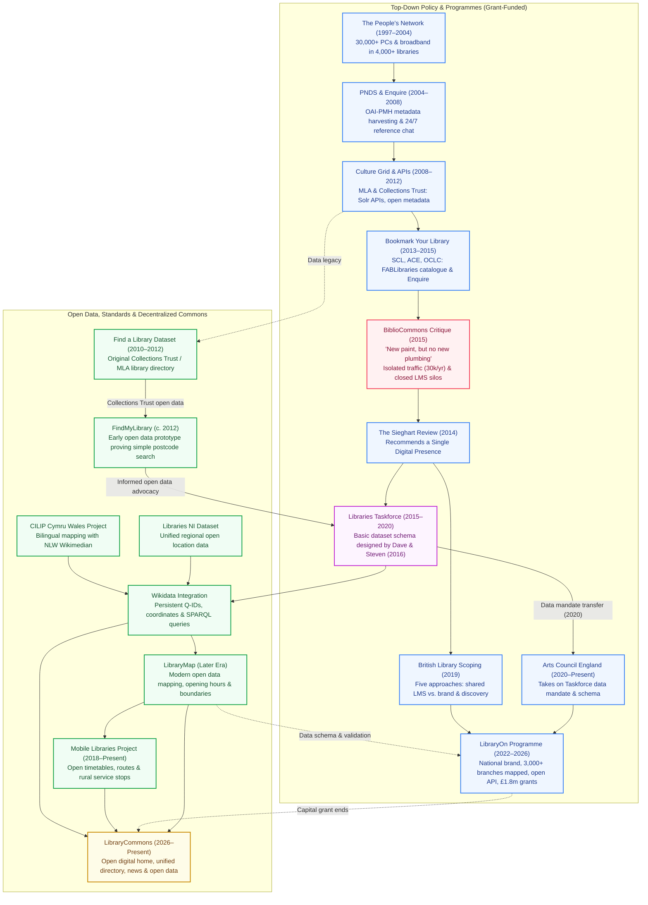

# From Culture Grid to LibraryCommons: The 30-Year Quest for a Single Digital Presence in UK Public Libraries

In November 2026, the British Library published its final evaluation report on [LibraryOn](https://github.com/LibrariesHacked/uk-public-library-policy-archive/tree/main/archive/reports/single-digital-presence-programme-report/report.md) — the culmination of a four-year, £3.4 million capital investment funded by Arts Council England to build a modern "Single Digital Presence" for public libraries.

With a unified directory of over 3,000 library service points, a public-facing discovery platform, and nearly £1.8 million disbursed directly to local library services for digital innovation, LibraryOn marks the most concerted national digital effort for English libraries in over a decade.

Yet for anyone who has worked with library data over the last thirty years, the story of the Single Digital Presence is not new. It is a recurring cyclical epic spanning four distinct technological eras: from the lottery-funded hardware rollout of the late 1990s, through the open metadata APIs of the Culture Grid in the 2000s, to the ill-fated "Bookmark Your Library" portal of 2013, early open data prototypes like **FindMyLibrary**, the pivotal schema work of the Libraries Taskforce in 2016, and finally to modern platforms like **LibraryMap**, LibraryOn, and **LibraryCommons**.

Each chapter set out with the same noble vision: to unite the UK’s fragmented local library services into a cohesive, findable, and transactional national digital offer. And each chapter ran headfirst into the same structural immovable objects: local authority autonomy and proprietary Library Management System (LMS) vendor silos.

Here is the 30-year history of how we got here, why earlier iterations stalled, and how the continuous thread of open data—from **Find a Library** and **FindMyLibrary**, through the **Libraries Taskforce**, **CILIP Wales**, **Libraries NI**, and **Wikidata**, to **LibraryMap**, **Mobile Libraries**, and **LibraryCommons**—provides the only lasting foundation for a digital public library network.

---

## 1. The Hardware & Connectivity Era (1997–2004)

The journey began not with web applications or shared APIs, but with wires and beige desktop computer towers. 

In 1997, the Library and Information Commission (LIC) published its landmark report, [New Library: The People's Network](https://github.com/LibrariesHacked/uk-public-library-policy-archive/tree/main/archive/reports/lic-new-library-the-peoples-network-1997/report.md), followed a year later by [Building the New Library Network](https://github.com/LibrariesHacked/uk-public-library-policy-archive/tree/main/archive/reports/lic-building-the-new-library-network-1998/report.md). The thesis was revolutionary for its time: public libraries should serve as the universal public on-ramp to the "Information Superhighway."

Backed by more than £100 million of National Lottery funding through the New Opportunities Fund, the People's Network successfully installed over 30,000 internet terminals and broadband connections across more than 4,000 public library buildings by 2004. 

It was a triumph of capital infrastructure. However, once the computers were in place and the public was logging on, an obvious question arose: *Where was the shared digital content, and how would users discover what was held across the country's public libraries?*

---

## 2. The Aggregation Era: PNDS, Culture Grid, and "Find a Library" (2004–2012)

By the mid-2000s, attention shifted from physical connectivity to digital discovery. The Museums, Libraries and Archives Council (MLA) took charge of coordinating national digital initiatives, giving birth to two foundational projects:

### The People's Network Discovery Service (PNDS) & Enquire
The MLA established the People’s Network Discovery Service, which sought to harvest and cross-search digital content across local libraries, archives, and regional hubs. Contributors exposed collections via **OAI-PMH** (Open Archives Initiative Protocol for Metadata Harvesting) using the **PNDS Dublin Core Application Profile (PNDS DCAP)**. 

Alongside this sat **Enquire**, a 24/7 virtual reference enquiry service. Powered by OCLC’s QuestionPoint software and staffed collaboratively by public librarians across the country, Enquire demonstrated that library staff could deliver a shared, live national service even if their physical services remained local.

### The Culture Grid APIs
In 2008, the MLA expanded this into the **Data Aggregation Programme**, partnering with the **Collections Trust** to launch the **Culture Grid**. 

The Culture Grid was an ambitious open-data and interoperability engine. Rather than simply building a consumer website, it provided a centralized metadata aggregation platform with **SOLR REST APIs**, OpenSearch endpoints, and OAI-PMH harvesting. It aggregated millions of digital objects and catalog records from over 50 contributing institutions, syndicating UK cultural collections directly to Europeana, the BBC, and Wikipedia.

### The Original "Find a Library" Project
Crucially for public libraries, the Culture Grid team recognized a glaring blind spot: the UK had no single, authoritative open dataset of where public libraries actually were, when they were open, or what services they provided.

Working in partnership with the Society of Chief Librarians (SCL) and Directgov (the predecessor to GOV.UK), the MLA and Collections Trust collated and structured data for over 4,000 public library service points into a national directory. The **Find a Library API** allowed external developers and public portals to query local library services by postcode or coordinates for the very first time.

### Why the Aggregation Era Stalled
The Culture Grid was technically forward-thinking, but politically vulnerable:
1. **The 2010 Austerity Cliff-Edge**: In the 2010 government spending review, the Coalition government announced the abolition of the MLA under its "bonfire of the quangos." By March 2012, the MLA was formally wound down, and central strategic funding for national data aggregation disappeared.
2. **Metadata Burden**: Small local authorities struggled to maintain strict OAI-PMH endpoints and PNDS Dublin Core schemas without ongoing central technical assistance.
3. **Retirement**: The Collections Trust eventually retired the Culture Grid around 2015. 

When central government walked away, the authoritative dataset of UK libraries risked vanishing with it.

---

## 3. The First "Single Digital Presence": Bookmark Your Library (2013–2015)

In March 2013, the Society of Chief Librarians (now Libraries Connected), Arts Council England, The Reading Agency, and OCLC launched **Bookmark Your Library** (`bookmarkyourlibrary.org.uk`).

Promoted as a single national digital destination, Bookmark Your Library attempted to bundle three distinct elements into one consumer portal:
1. **FABLibraries (*Find a Book in Libraries*, `fablibraries.worldcat.org`)**: A national union catalogue powered by OCLC WorldCat, ingesting catalog dumps mirrored from **UnityUK** (the UK's interlending database).
2. **Enquire**: The 24/7 virtual chat service.
3. **Find a Library**: A service directory powered by the Collections Trust location dataset.

### The Post-Mortem: "New Paint, But No New Plumbing"
Despite heavy promotional campaigns, Bookmark Your Library quickly proved to be a cautionary tale. In late 2015, BiblioCommons and SCL published the landmark report [Essential Digital Infrastructure for Public Libraries in England: A plan for moving forward](https://github.com/LibrariesHacked/uk-public-library-policy-archive/tree/main/archive/reports/scl-essential-digital-infrastructure-2015/report.md). The report delivered an uncompromising critique of the Bookmark Your Library model:

- **Surface Paint vs. Foundational Plumbing**: Users on Bookmark Your Library could search for a title across the country, but the platform had no live two-way connection to local Library Management Systems. A user could not see if a book was actually sitting on the shelf, could not join their local library online, and could not reserve the book without being kicked out to a separate, disjointed local council OPAC.
- **The "Island" Trap and Traffic Reality**: Local authority library catalogues already enjoyed massive, organic footfall—a typical council catalogue (like Doncaster) received around 300,000 visits per month. In contrast, **Bookmark Your Library attracted roughly 30,000 visits in an entire year across the whole of England**. By isolating national content on an external marketing portal rather than integrating into local discovery layers, the platform failed to reach real users.
- **LMS Vendor Fragmentation**: With 151 English library authorities using disparate proprietary LMS software (Axiell, Civica, SirsiDynix, Infor, Capita), the lack of standardized, open transactional APIs made real interoperability impossible.

As SCL President Ciara Eastell concluded at the time: *"We can no longer think of a digital offer as something optional or separate... they provide new paint, but no new plumbing."*

---

## 4. The Grassroots & Open Data Revolution: FindMyLibrary, Taskforce, and Beyond (2012–2020)

While national committees debated why consumer portals kept failing, the open data community and progressive practitioners recognized that before you can build a national digital presence, you must first have **authoritative, open data**.

### FindMyLibrary (c. 2012): The First Open Data Prototype
When the Collections Trust published the original 4,000-branch library location dataset in 2012 under the Open Government Licence, it offered a brief glimpse of what was possible. Recognizing that public library discovery didn’t need a bloated national portal, **Dave Rowe** built **FindMyLibrary** around 2012. 

FindMyLibrary was a clean, lightning-fast open data prototype: give it a postcode or location, and it instantly showed your nearest libraries, opening times, and council contact links. It demonstrated a vital proof of concept: **when data is genuinely open, lightweight applications can deliver better user experiences than multi-million-pound national projects.**

### The Libraries Taskforce Basic Dataset (2016): Dave & Steven
Following [The Sieghart Review (2014)](https://github.com/LibrariesHacked/uk-public-library-policy-archive/tree/main/archive/reports/independent-library-report-for-england-2014/report.md), the government established the **Libraries Taskforce** to implement [Libraries Deliver: Ambition for Public Libraries in England 2016–2021](https://github.com/LibrariesHacked/uk-public-library-policy-archive/tree/main/archive/reports/libraries-taskforce-ambition-action-plan-2016/report.md).

One of the Taskforce's most urgent priorities was addressing the scandalous reality that in 2016, central government still did not maintain an official, public list of England’s libraries.

To fix this, **Dave Rowe** (Libraries Hacked) and **Steven Heywood** (Taskforce secondee) designed the schema for the **Libraries Taskforce Basic Dataset**. Published on GOV.UK and data.gov.uk, this dataset established the first rigorous national standard:
- Categorizing libraries by statutory governance (council-run, commissioned, community-managed, or independent).
- Defining unique identifier conventions, address components, and geographic coordinates.
- Collating verified returns from all 151 English public library authorities.

This was not a marketing platform; it was fundamental open data plumbing.

### Connecting the Four Nations: CILIP Cymru Wales & Libraries NI
This open data momentum quickly bridged borders across the UK:
- **CILIP Cymru Wales**: Led by Kathryn Parry alongside Jason Evans (the National Library of Wales Wikimedian in Residence), CILIP Cymru Wales undertook the **Welsh Library Open Data Project**. They compiled, verified, and mapped every public library across Wales, pushing rich, bilingual open datasets (English and Welsh names, services, and local authority alignments) into the open ecosystem.
- **Libraries NI**: Operating as a unified regional body, Northern Ireland provided a clean, centralized open dataset of its entire library network, bypassing the council fragmentation seen in England.

### Wikidata: The Linked Open Data Backbone
Rather than letting these datasets sit in isolated spreadsheets, the community connected them directly to **Wikidata**. 

By assigning persistent Wikidata Q-identifiers to every public library branch across England, Scotland, Wales, and Northern Ireland, libraries became first-class entities in the global semantic web. Anyone could now run open SPARQL queries to extract library locations, cross-reference them with census deprivation indices, map them against public transit routes, or build interactive visualizations without commercial gatekeepers.

### LibraryMap: Modern Spatial Discovery
As open datasets matured, the need arose for a dedicated, permanent mapping platform. Built on the Taskforce schema and updated continually, **LibraryMap** (`librarydata.uk`) arrived to take open spatial discovery to a new level.

LibraryMap brought together:
- Interactive nationwide mapping across local authority boundaries.
- Live tracking of opening hours, branch facilities, and statutory governance types.
- Open REST APIs powering third-party applications, researchers, and local campaigns.

### The Mobile Libraries Project: Revealing the Rural Lifeline
If static branch libraries were poorly represented, mobile libraries were completely invisible to national policy.

Mobile libraries serve the most isolated, rural, and digitally excluded populations. Yet almost every major national policy report — from *New Library* to *Bookmark Your Library* — virtually ignored mobile services. Their schedules, routes, and physical stops were trapped inside static PDFs, buried deep within council subpages, or printed on paper flyers.

As highlighted in policy research like the Scottish Library and Information Council’s [Mobile Libraries in Scotland (2024)](https://github.com/LibrariesHacked/uk-public-library-policy-archive/tree/main/archive/reports/slic-mobile-libraries-in-scotland-2024/report.md) and [Libraries on the Move (2019)](https://github.com/LibrariesHacked/uk-public-library-policy-archive/tree/main/archive/reports/slic-libraries-on-the-move-2019/report.md), rural service delivery requires precision timetable data.

Libraries Hacked tackled this by building the **Mobile Libraries project** (`mobilelibraries.org`). By manually and programmatically scraping council timetables, parsing stop frequencies, and mapping thousands of individual mobile stops down to village greens, laybys, and care homes, the project created the first-ever open, national timetable dataset of mobile library routes in the UK.

### Taskforce Data Transitions to Arts Council England (2020)
When the Libraries Taskforce formally disbanded around March 2020, its open data mandate did not disappear. Stewardship of the national basic dataset transitioned directly to **Arts Council England (ACE)**. 

ACE took over ongoing collection, maintenance, and publication of the English public libraries dataset, cementing the open schema designed by Dave and Steven as the permanent statutory baseline.

---

## 5. Re-imagining the Vision: Sieghart to the British Library Scoping (2014–2019)

Parallel to this bottom-up data revolution, national policy work on a "Single Digital Presence" continued:

- **[Five Approaches to a Single Digital Presence (2019)](https://github.com/LibrariesHacked/uk-public-library-policy-archive/tree/main/archive/reports/single-digital-presence-scoping-report/report.md)**: Funded by Arts Council England and the Carnegie UK Trust, the British Library led a thorough scoping exercise that modeled five potential paths forward:
  1. *Deep Shared Infrastructure*: A single national LMS procured for all authorities.
  2. *UK-Wide Content Discovery*: A national aggregator for digitized local history and public collections (akin to Gallica or Trove).
  3. *Unified Digital Lending*: A single national e-book platform.
  4. *Safe Social Space*: A community platform connecting readers and staff.
  5. *One Library Brand*: A unifying brand identity and digital "front door."

The 2019 scoping report concluded that procuring a single national LMS was neither politically feasible nor immediately desirable given local governance autonomy. Instead, it recommended focusing on brand identity, national promotion, and open sector collaboration.

---

## 6. LibraryOn (2022–2026): A Modern Front Door

In 2022, backed by a £3.4 million capital grant from Arts Council England and £1.4 million in British Library revenue match, the British Library launched the **LibraryOn** programme.

Crucially, rather than trying to build a new directory from scratch, LibraryOn built directly on the open data lineage established by the Taskforce, Arts Council England, and Libraries Hacked. Working in close collaboration with Dave Rowe (acknowledged in the final report), the team constructed an open, self-service dataset and API of over 3,000 public libraries.

The newly released [LibraryOn Programme Evaluation (November 2026)](https://github.com/LibrariesHacked/uk-public-library-policy-archive/tree/main/archive/reports/single-digital-presence-programme-report/report.md) demonstrates clear and tangible successes within its capital remit:

- **A Vibrant Public-Facing Brand**: Created `libraryon.org`, positioning public libraries as vibrant, essential modern community hubs.
- **National Library Finder & Open Dataset**: Built an interactive map and open API encompassing over 3,000 public library locations, standardizing accessibility, facilities, and service metadata.
- **Audience Reach**: Generated over 280,000 visitor sessions, with 22% of visitors following onward referral links directly to local council library websites.
- **Local Capacity Investment**: Disbursed nearly £1.8 million through 63 digital grants across 90 English library authorities (59% of all services), funding virtual 3D tours, redesigned local websites, app development, and LMS integrations.
- **Sector Upskilling**: Reached 77% of English public library services through expert community-of-practice webinars and masterclasses.

---

## 7. The Next Chapter: LibraryCommons and Sustainable Open Infrastructure

As the LibraryOn capital delivery period concludes in 2026, the library sector finds itself facing the familiar question: *What happens when the capital funding ends?*

Top-down national programmes, no matter how well-executed, are inevitably bound to fixed funding lifecycles. When the grant closes, centralized teams disband, and marketing campaigns taper off.

This is where **LibraryCommons** enters the story.

Conceived as an independent, sustainable, community-driven digital platform, LibraryCommons represents the culmination of this 30-year journey:

1. **A Digital Home for Public Libraries**: Rather than existing as a transient campaign site, LibraryCommons acts as an open digital home that brings together library locations, branch facilities, service news, and datasets from across the UK into one place.
2. **Carrying the Legacy Forward**: LibraryCommons is designed to preserve and carry forward the vital directory data, content, and open datasets refined through Find a Library, FindMyLibrary, the Taskforce dataset, LibraryMap, the Mobile Libraries project, and LibraryOn, ensuring that public data assets are never lost to another funding sunset.
3. **A True Digital Commons**: By anchoring the platform in open-source tooling, open data standards, and distributed stewardship, LibraryCommons operates as a public utility for library users, staff, researchers, and developers alike.

---

## 8. What 30 Years of Policy Teaches Us About Library Data

Looking back from the People's Network in 1997 through Culture Grid, Bookmark Your Library, FindMyLibrary, the Libraries Taskforce, LibraryMap, and LibraryOn to LibraryCommons, three structural lessons stand out:

### 1. Portals Cannot Substitute for Plumbing
The central finding of the 2015 BiblioCommons report remains true today: **a digital front door can inspire, but it cannot transact without backend plumbing**. 

Until a user can click "Join" on a national website and instantly receive a working digital card, or click "Borrow" and have a physical hold placed on their local authority LMS or open an e-book in their browser, national platforms will inevitably act as signposts rather than services.

### 2. The Contrast Between England and Its Neighbors
The divergence between UK nations is instructive:
- In the **Republic of Ireland**, the Local Government Management Agency (LGMA) centrally procured a single shared LMS (**Libraries Ireland**, running Innovative Sierra) across all 31 local authorities. Every citizen holds a single card capable of reserving any book from any public library across the entire country with centralized courier delivery.
- In **Scotland**, the Scottish Library and Information Council (SLIC) facilitated consortia-level LMS sharing across multiple local authorities.
- In **Northern Ireland**, Libraries NI operates as a single regional authority with a single unified catalog.
- In **England**, 151 separate local authorities remain bound to individual council procurement frameworks, meaning shared infrastructure requires voluntary consensus rather than statutory alignment.

### 3. Open Data is the Only Infrastructure That Survives
Centralized platforms and government programs come and go with funding cycles. The MLA was abolished; the Culture Grid was retired; Bookmark Your Library was shuttered; the Libraries Taskforce concluded; LibraryOn's capital delivery period has now ended.

What endures through every single shift is **standardized open data**. 

When library locations, opening times, mobile stops, unique identifiers, and catalog holdings are exposed via open, machine-readable standards under permissive licenses, the ecosystem does not collapse when a project ends. Open initiatives like FindMyLibrary, LibraryMap, the Mobile Libraries project, Wikidata, and LibraryCommons prove that the most resilient digital presence is one built on open, shared foundations.

---

## Relevant Policy Archive Reports

Every key milestone cited in this article is fully transcribed, catalogued, and openly readable in the [UK Public Library Policy Archive](https://github.com/LibrariesHacked/uk-public-library-policy-archive):

* **1997**: [New Library: The People's Network](https://github.com/LibrariesHacked/uk-public-library-policy-archive/tree/main/archive/reports/lic-new-library-the-peoples-network-1997/report.md) — *Library and Information Commission*
* **1998**: [Building the New Library Network](https://github.com/LibrariesHacked/uk-public-library-policy-archive/tree/main/archive/reports/lic-building-the-new-library-network-1998/report.md) — *Library and Information Commission*
* **2003**: [Framework for the Future: 10 Year Vision](https://github.com/LibrariesHacked/uk-public-library-policy-archive/tree/main/archive/reports/dcms-framework-for-the-future-2003/report.md) — *DCMS*
* **2014**: [Independent Library Report for England (The Sieghart Review)](https://github.com/LibrariesHacked/uk-public-library-policy-archive/tree/main/archive/reports/independent-library-report-for-england-2014/report.md) — *William Sieghart / DCMS*
* **2015**: [Essential Digital Infrastructure for Public Libraries in England](https://github.com/LibrariesHacked/uk-public-library-policy-archive/tree/main/archive/reports/scl-essential-digital-infrastructure-2015/report.md) — *BiblioCommons / Society of Chief Librarians*
* **2016**: [Libraries Deliver: Ambition for Public Libraries in England 2016–2021](https://github.com/LibrariesHacked/uk-public-library-policy-archive/tree/main/archive/reports/libraries-taskforce-ambition-action-plan-2016/report.md) — *Libraries Taskforce*
* **2019**: [Digital Transformation for UK Public Libraries: Five Approaches to a 'Single Digital Presence'](https://github.com/LibrariesHacked/uk-public-library-policy-archive/tree/main/archive/reports/single-digital-presence-scoping-report/report.md) — *The British Library / Arts Council England / Carnegie UK Trust*
* **2019**: [Libraries on the Move: A Review of Public Mobile Library Services in Scotland](https://github.com/LibrariesHacked/uk-public-library-policy-archive/tree/main/archive/reports/slic-libraries-on-the-move-2019/report.md) — *Scottish Library and Information Council*
* **2024**: [Mobile Libraries in Scotland: Strategy and Practice](https://github.com/LibrariesHacked/uk-public-library-policy-archive/tree/main/archive/reports/slic-mobile-libraries-in-scotland-2024/report.md) — *Scottish Library and Information Council*
* **2026**: [LibraryOn Programme Evaluation: Shaping the Single Digital Presence for Libraries](https://github.com/LibrariesHacked/uk-public-library-policy-archive/tree/main/archive/reports/single-digital-presence-programme-report/report.md) — *The British Library / Arts Council England*
