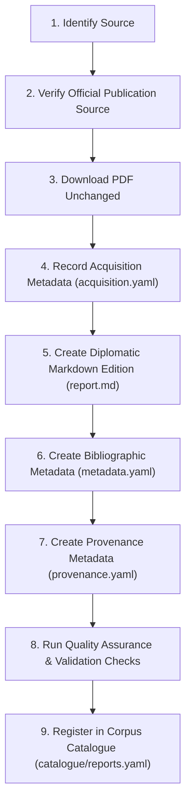

# Archival Ingestion and Quality Assurance Workflow

## Overview

This document defines the standard nine-stage workflow for acquiring, preserving, transcribing, validating, and cataloguing a document in the **UK Public Library Policy Archive**.

The workflow is designed for a **single maintainer** using plain-text configuration files, standard command-line utilities, and optional model-agnostic prompts from [`prompts/`](../prompts/). Every step is deterministic and auditable so that a future maintainer can reproduce or verify any archived record from repository documentation alone.

---

## Summary of the Nine Stages



---

## Stage-by-Stage Procedure

### Stage 1: Identify Source

1. Select a target publication from [`catalogue/planned-reports.yaml`](../catalogue/planned-reports.yaml) or identify a qualifying UK public library policy, strategy, standards, consultation, or review document published from c. 1995 onwards.
2. Assign a permanent, lowercase hyphenated report slug (`<report-slug>`, e.g., `dcms-framework-for-the-future-2003` or `sieghart-independent-library-report-2014`).
3. Create the report directory structure under `archive/reports/<report-slug>/`:
   ```text
   archive/reports/<report-slug>/
   ├── assets/
   ├── scans/
   └── source/
   ```
4. If using an LLM assistant to help locate the canonical source URL, use the prompt in [`prompts/source-acquisition.md`](../prompts/source-acquisition.md).

---

### Stage 2: Verify Official Publication Source

Before downloading any file, verify the authenticity of the source using the checklist and prompt in [`prompts/source-verification.md`](../prompts/source-verification.md):

1. **Publisher identity**: Confirm that the hosting domain belongs to the official publishing authority (e.g., `gov.uk`, `gov.scot`, `gov.wales`, `communities-ni.gov.uk`, `artscouncil.org.uk`, `librariesconnected.org.uk`, `scottishlibraries.org`, `bl.uk`) or an official national web archive (`webarchive.nationalarchives.gov.uk`).
2. **Edition completeness**: Confirm that the PDF is the complete final publication (or clearly labelled consultation/draft if archiving a consultation) rather than an undated press summary.
3. **Licence verification**: Confirm the licensing terms (such as Crown Copyright under the Open Government Licence v3.0) printed on the imprint page or publication landing page.

---

### Stage 3: Download PDF Unchanged

1. Download the authoritative PDF directly into `archive/reports/<report-slug>/source/`:
   ```bash
   curl -L --fail --proto '=https' -o archive/reports/<report-slug>/source/source-document.pdf "<DIRECT_PDF_URL>"
   ```
2. **Critical Preservation Rule**: Do **not** open and re-save the PDF, do **not** run destructive OCR that rewrites the PDF file, and do **not** compress or alter its metadata. The preserved file in `source/` must remain an exact bit-for-bit copy of the file served by the publisher.
3. Compute the SHA-256 digest of the downloaded PDF immediately.

---

### Stage 4: Record Acquisition Metadata

1. Copy [`templates/acquisition.yaml`](../templates/acquisition.yaml) to `archive/reports/<report-slug>/acquisition.yaml`.
2. Record the point-of-capture details immediately:
   - `source_url`: The official landing page URL.
   - `source_pdf_url`: The direct PDF download URL.
   - `acquired_date` and `accessed_date`: Today's date in `YYYY-MM-DD` format.
   - `download_method`: How the file was fetched (e.g., `curl`, `browser-direct`).
   - `pdf_sha256`: The 64-character lowercase SHA-256 checksum of the downloaded PDF.
   - `licence`: The observed licence statement.
   - `notes`: Any relevant capture context (e.g., UK Government Web Archive snapshot timestamp).

---

### Stage 5: Create Markdown Edition

1. Copy [`templates/report.md`](../templates/report.md) to `archive/reports/<report-slug>/report.md`.
2. Transcribe the source PDF into diplomatic Markdown following [`docs/markdown-specification.md`](../docs/markdown-specification.md) and the strict instructions in [`prompts/pdf-conversion.md`](../prompts/pdf-conversion.md):
   - Include YAML front matter (`id`, `title`, `year`, etc.).
   - Insert `<!-- PAGE: N -->` at the start of every single page without exception. When a page break falls in the middle of a sentence or paragraph, place `<!-- PAGE: N -->` INLINE (`word <!-- PAGE: N --> word`) so CommonMark HTML previews do not fracture the sentence into two separate `<p>` tags with vertical margins.
   - Format numbered policy paragraphs with bold numbers (`**1.**`, `**1.1**`), never bare `1. `, preventing list resets across headings and callouts.
   - Format all callout boxes and case studies as blockquotes with explicit headings (`> ### Case Study: [Title]`).
   - Maintain natural paragraph continuity, native Markdown lists, and definition lists for glossaries (`- **Term** — Definition`).
   - Preserve exact wording, spelling, punctuation, heading hierarchy, tables, footnotes (`[^1]`), appendices, tables of contents, and references.
   - Complete Image Audit: Extract all content photos, figures, and author signatures into `archive/reports/<report-slug>/assets/figure-NNN.jpg` and embed them with verbatim italicised captions (`*Verbatim caption*`).
   - Mark any illegible or ambiguous OCR passages with `[UNCERTAIN]` rather than guessing.

---

### Stage 6: Create Bibliographic Metadata

1. Copy [`templates/metadata.yaml`](../templates/metadata.yaml) to `archive/reports/<report-slug>/metadata.yaml`.
2. Populate the fields using **only directly observable publication evidence** from the document and its official landing page, following [`docs/metadata-schema.md`](../docs/metadata-schema.md) and [`prompts/metadata-generation.md`](../prompts/metadata-generation.md).
3. Ensure that `id`, `title`, and `year` in `metadata.yaml` match the YAML front matter of `report.md` exactly.
4. Set missing optional fields to `null`—never infer or invent values.

---

### Stage 7: Create Provenance Metadata

1. Copy [`templates/provenance.yaml`](../templates/provenance.yaml) to `archive/reports/<report-slug>/provenance.yaml`.
2. Populate all required and applicable fields (`source_url`, `source_pdf_url`, `acquired_date`, `accessed_date`, `source_checksum`, `pdf_sha256`, `download_method`, `conversion_method`, `conversion_date`, `review_status`) as specified in [`docs/preservation.md`](../docs/preservation.md).

---

### Stage 8: Run Quality Assurance Checks

1. Perform a comparative editorial check between the source PDF and `report.md` using the criteria in [`prompts/qa-review.md`](../prompts/qa-review.md):
   - Verify no pages are missing or out of sequence.
   - Verify no paragraphs, headings, tables, figures, appendices, or footnotes were omitted.
   - Verify all `[UNCERTAIN]` markers are genuine source ambiguities or resolve any transcription errors against the PDF.
2. Update `review_level` in `metadata.yaml` and `review_status` in `provenance.yaml` (`converted` -> `reviewed` -> `verified`).
3. Run the automated validation checks (equivalent to the GitHub Actions workflows in `.github/workflows/`):
   - **Corpus Completeness**: Confirm `report.md`, `metadata.yaml`, `provenance.yaml`, and `acquisition.yaml` exist.
   - **Schema Validation**: Validate `metadata.yaml` against `schemas/metadata.schema.json` and `provenance.yaml` against `schemas/provenance.schema.json`.
   - **Markdown Validation**: Verify YAML front matter, sequential `<!-- PAGE: N -->` markers, and footnote integrity.
   - **Checksum Fixity**: Verify `pdf_sha256` and `source_checksum` match the actual SHA-256 hash of the PDF in `source/`.

---

### Stage 9: Add to Catalogue

1. Add a summary entry for the newly archived report to [`catalogue/reports.yaml`](../catalogue/reports.yaml), including `id`, `title`, `year`, `publisher`, `country`, `path`, and `review_level`.
2. If the report was listed in [`catalogue/planned-reports.yaml`](../catalogue/planned-reports.yaml), update its status or link its archived `id` accordingly.
3. Commit the complete report package and catalogue update to Git in a single atomic commit.
